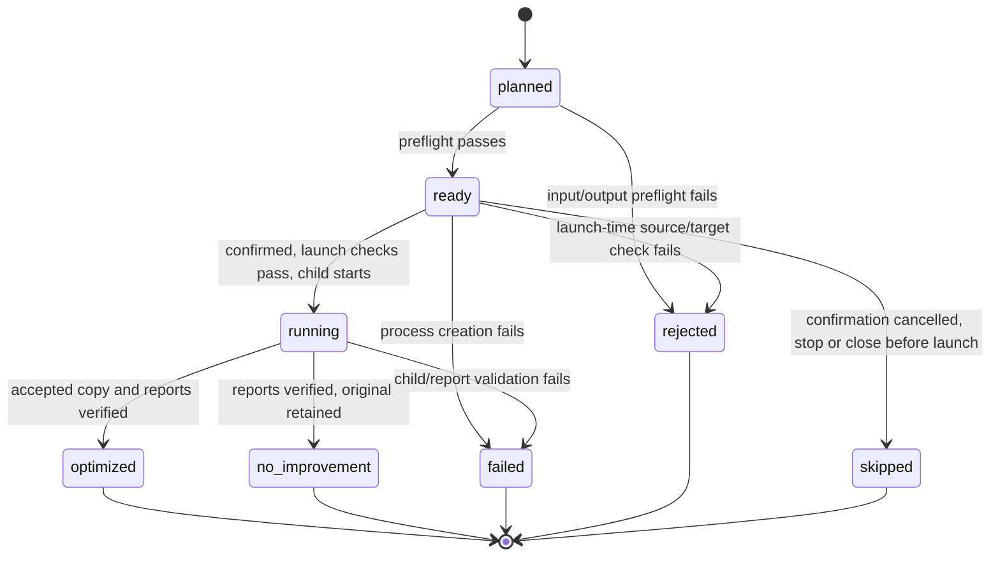

# ADR-001: Headless batch workflow with a thin Windows GUI

**Status:** Accepted and implemented
**Date:** 2026-10-25
**Decider:** Repository maintainer

## Context

The production optimizer already owns input validation, transformations,
preservation checks, performance selection and exclusive publication. The first
Windows GUI correctly reused that CLI, but placed selection, naming, process
management and result interpretation directly in Tk callbacks. The first native
picker smoke showed why that boundary is too weak: choosing files and authorizing
a long-running operation are different actions, and UI automation is not a safe
substitute for a visible review step.

The batch workflow must remain sequential, preserve originals, survive individual
failures and never create a second acceptance path. It also needs a foundation for
safe stop/recovery and exact-context checkpoint reuse without turning the optimizer
into a generic job framework.

## Decision

Before adding the next lifecycle feature, extract a small headless batch controller
from `viewing_copy_gui.py`. The GUI will select files, render controller state and
forward user intent. The controller will plan immutable jobs, enforce state
transitions, own the single active child process and interpret the CLI's final JSON
report. `optimize_pdf.py --viewing-copy` remains the only production execution and
publication path.

| Boundary | Responsibility |
|---|---|
| `viewing_copy_gui.py` | Native selection, review/confirmation, status display and user controls |
| Planned `batch_workflow.py` | Batch planning, source/output identity, state transitions, structured events and sequential process ownership |
| `optimize_pdf.py` | Public CLI, input policy and dispatch to the production optimizer |
| `viewing_copy.py` | Candidate generation, preservation/performance gates and exclusive publication |
| Per-file JSON report | Evidence for `optimized` and `no improvement` after validation; stdout is display-only progress |

Each job will have one immutable source SHA256 and proposed output set. Duplicate
selections collapse to one job before confirmation. The controller rechecks the
source and all targets before launch, then passes the confirmed hash into the
production optimizer as an optional expected-source constraint. The optimizer must
check this hash at initialization and again before any output/report publication;
it must never replace the expected hash with a newly observed hash. A mismatch
fails without publication. This closes the gap between controller validation and
child initialization; validating a report after publication is insufficient.
Existing CLI/API callers that omit the constraint retain current behavior.
Document and test the additive interface when implemented. Exclusive writes remain
the final output-collision guard; preservation and performance gates are unchanged.

Only a successful child exit with validated reports can establish `optimized` or
`no improvement`. `timeout` and `budget exhausted` are typed controller outcomes,
not inferred success. Validate the report's source path/hash against the confirmed job;
for `optimized`, also verify the planned output path and published file hash.
The controller owns `failed`, `rejected` and `skipped` records and their reasons;
these do not require optimizer reports. Confirmation cancel skips every ready job
without launching a child and leaves existing rejection reasons intact.

The first stop control will be **stop after current file**. Hard cancellation is
deferred until the controller can terminate only its owned process tree and prove
temporary-file cleanup. Block window close from launch initiation through execution,
publication and terminal-result recording. Between jobs, closing disables further
launches and marks queued ready jobs `skipped` before destroying the window.
Serialize stop/close handling with launch decisions: if launch has begun, close is
blocked; if close is accepted first, no child may start. Stop-after-current preserves
completed results and skips queued ready jobs after the active job finishes.

## Options considered

### Keep orchestration in Tk callbacks

Lowest initial code, but state is implicit, hard to test without a desktop, and
every lifecycle feature adds another GUI-specific branch. Rejected.

### Add a small headless controller

Adds one focused module only when the next lifecycle feature needs it. It makes
planning and transitions deterministic while retaining one optimizer process and
one publication policy. Accepted.

### Add batch behavior inside `optimize_pdf.py`

Would enlarge the public CLI/API surface and mix user-interface orchestration with
single-document safety logic. Rejected for P10; revisit only if non-GUI callers
demonstrate a real batch-API requirement.

## Consequences

- UI tests can focus on rendering and intent; controller tests cover ordering,
  races, failures and lifecycle transitions without automating the desktop.
- The GUI cannot declare success from an exit code or log line; it must validate
  the report and expected published files.
- Production checkpoint reuse can later attach to a job's exact source/tool/context
  identity without weakening first-run checks.
- A little orchestration code moves out of the GUI. No plugin system, scheduler,
  parallel executor or persistent database is introduced.

## Safety invariants

- No child starts before the user reviews and confirms exact source/output pairs.
- One document runs at a time; a terminal result is recorded before the next starts.
- Originals and existing outputs/reports are never overwritten or renamed.
- Source changes, output collisions, missing/malformed reports and unknown statuses
  fail that job closed and do not block later jobs.
- Only an owned process tree or owned temporary path may be cleaned up.
- Encrypted/signed-input rejection and every production preservation/performance
  threshold remain unchanged.
