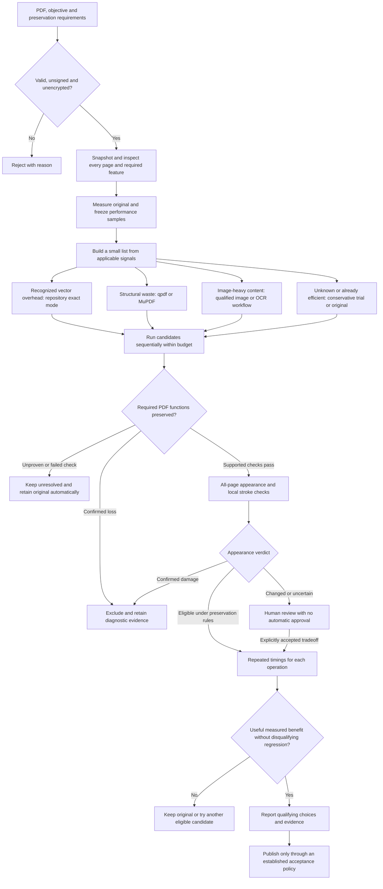

# Main improvement plan: adaptive optimizer selection

**Status: active, primary roadmap. Adopted 2026-10-18.** Start future improvement
work here. This is the maintained plan for the next iteration; it supersedes the
old comparison handoff as a work queue. Update this file when priorities change
instead of creating a competing plan.

The goal is to select a small set of PDF optimizers from the source's actual
structure and the user's objective, then verify which results are useful.
**File characteristics select candidates; preservation and measurements select
outputs.** Expected benefits are hypotheses until measured.

This document describes completed and planned work. Current production behavior and acceptance
rules remain in [design.md](design.md). The existing exhaustive comparison runner
is documented in [comparison.md](comparison.md). The companion classifier/planner
does not replace the production acceptance path; production exact checkpoint reuse
and batch restart recovery are implemented as described under P11.

## Current foundation and immediate priority

The maintained implementation already includes:

- Production viewing-copy generation and its existing preservation/performance
  gates, plus the legacy CLI/Python modes.
- A separate fixed-profile comparison runner with independent function/appearance
  checks, native Firefox measurements, visual evidence and reports.
- Comparison progress logs and heartbeats, real canvas/detail zoom completion
  tracking, and append-only per-operation records. Those research-run records do
  not provide automatic resume.
- Separate PDF-function and source-image-region findings, alongside descriptive
  missing/added ink, displacement, thickness and topology measurements.

**P12 is complete.** The Windows workflow now has keyboard-complete review and
controls, startup dependency diagnostics, clean setup/package verification and a
human-visible two-fixture acceptance run. Future work should begin with new measured
evidence rather than extending this delivery plan speculatively.
The architectural boundary is recorded in
[ADR-001](adr-batch-workflow.md); this roadmap remains the ordered work queue.

Run progress belongs in ignored `audit-output/`, not in this roadmap. Consult the
relevant run's completed records, final status, hashes and report for current
facts; do not infer completion from an older chat or partial assessment. Keep
private files, paths, screenshots and detailed comparison reports out of commits.
Do not change the running implementation during an active comparison.

## Scope and fixed boundaries

Build the first version as a companion planner/runner using the maintained tools.
Keep `optimize_pdf.optimize(...)`, existing CLI modes, production transformations
and acceptance thresholds unchanged. Automatic publication of external outputs
needs its own supported preservation proof; never fabricate an internal
transformation manifest for an external optimizer.

Retain the original on failed or unproven preservation. Reject encrypted/signed
inputs consistently with repository policy. Use source snapshots, exclusive
outputs, trusted command-prefix arrays, pinned tool interfaces, sequential tools
and documents, owned-process cleanup, and separate competitor environments.
No private uploads, cloud integrations, purchases or LLM service are required.

Lossy processing, OCR and matching `.note` workflows need their applicable user
intent and prerequisites. Evaluating lossy output does not authorize automatic
semantic approval of altered handwriting. Annotation editability loss may be
allowed for viewing copies; loss of required text/navigation/attachments is not.

## Decision flow

The input categories are non-exclusive; mixed pages may match several branches.
A risky page constrains any whole-document transformation. Each candidate is
compared directly with the immutable source, including candidates produced by a
deliberately tested chain.

When native instrumentation is unavailable, mark viewing performance unavailable;
do not relabel standalone PDF.js measurements as native Firefox. A storage result
may still be evaluated under the applicable existing rules. The human-review
branch does not bypass production publication gates.

## Candidate-selection policy

Keep the exhaustive comparison matrix as research mode. Normal optimization
should try a bounded, explained shortlist: initially at most two applicable
conservative candidates and one explicitly allowed experimental candidate.
This proposed scheduling limit is not a quality threshold.

| Candidate family | Eligibility signal and expected benefit | Restriction |
|---|---|---|
| Repository exact inlining/conversion | Recognized Form-call or eligible annotation overhead; possible drawing and storage reduction | Preserve widths, paths, transforms, clipping and paint order; unsupported representations are ineligible |
| Repository fast-handwriting | Recognized consecutive same-width runs; fewer painting operations may help | Separate appearance-sensitive candidate; legacy shading guards are not semantic approval |
| qpdf Flate/object streams | Compression or object-packing waste; primarily storage reduction | Do not expect simplification of handwriting or infer render gains from smaller bytes |
| qpdf linearized | Progressive network delivery is the objective | Ordinary local-file rendering is a different objective; skip this branch unless relevant |
| MuPDF clean | Duplicate objects/streams and structural overhead | Retain metadata/structure and independently verify features, appearance and interactions |
| mattdesl image optimizer | Oversampled photographs or inefficient raster encoding dominate | JPEG quality 95 is still lossy; downsampling/off-page blanking require explicit review |
| OCRmyPDF | Scanned/image PDFs, with OCR only when requested | Pin/verify a no-OCR interface for optimization-only work; O1 does not make every pipeline setting lossless |
| pdfsizeopt | TeX/LaTeX or font/image-heavy storage cases | Qualify the pinned implementation; no untested viewing benefit claim |
| Ghostscript pdfwrite | Explicitly permitted broad conversion/rewrite tradeoff | Experimental; presets are not preservation guarantees |
| Acrobat Optimizer | Licensed local workflow with recorded settings | Imported, source-hash-matched outputs; verify discard/flatten settings through independent checks |
| BOOX PDF vector | Supported annotation-heavy exports | Quarantine automatic recommendation until image-stamp/fraction-bar loss regressions are resolved; do not select from filename alone |
| BOOX PDF raster | Explicit visual tradeoff or diagnostic rendering comparison | Fixed resolution may lose width detail and PDF functions; never auto-approve mathematical handwriting |
| BOOX Note Optimizer | Supplied matching `.note` and an upstream export workflow | Separate workflow; pressure, width, point reduction and export fidelity need review |

Use [comparison.md](comparison.md#adapter-references) for upstream references and
the configured/pinned interfaces. These roles are planning rules, not universal
rankings or a substitute for testing the actual tool version.

Run alternatives from the source. Chain tools only for a detected remaining
opportunity, record every step, and verify the final output against the original.
Do not repeatedly lossy-encode a candidate. Missing tools and ineligible profiles
remain visible with reasons.

## P1: read-only characterization

Implemented helper: `tools/pdf_characterize.py` (schema 2). It reuses existing
parsers and navigation helpers and inventories every page with multiple labels and
explicit coverage/confidence:

- Stroke/fill and segment/curve counts; nested/repeated Forms; transforms,
  clipping, transparency and paint order.
- Constant/varying widths, exact same-width run opportunities, dots and filled
  outlines. A filled pressure stroke may have no meaningful PDF line-width value.
  Zero annotations does not mean zero handwriting.
- Eligible annotation appearances, image stamps and protected comments, forms,
  actions and layers.
- Unique/repeated images, compressed/decoded sizes, effective placement resolution,
  bit depth, color spaces and masks. Image count alone is not a bottleneck measure.
- Existing Unicode/math/search text, bookmark hierarchy/destinations/zoom, link
  targets/hit areas, labels, attachment hashes, forms, layers and structural tags.
- Escaped resource names, inherited/nested resources and unresolved content, with
  cycle/depth guards. The known density-sampler blind spot must not decide routes.

Use original-page timings to identify performance samples. Do not infer the slow
pages, stroke representation or best optimizer solely from an application label,
pen name, first page or dominant page type.

## P2-P3: explainable planning and bounded execution

Implemented planner: `tools/plan_optimization.py` (schema 1). Its plan JSON
contains source/tool hashes and versions, profile, eligibility evidence, expected
storage effect, target viewing operation, confidence, preservation risks, cost
estimate, prerequisites and a run/skip/unavailable decision with a reason.

Implemented runner: `tools/run_optimization_plan.py` (schema 1). It verifies the
source and planned tool hashes, rechecks pinned interfaces, executes only selected
candidates sequentially under time/output-size limits, isolates failures and keeps
the original snapshot as the final fallback. Generated external outputs remain
evidence only; independent function checks cannot approve publication.

Start with deterministic mechanism-based rules. Use “uncalibrated” when no
defensible range exists. Future empirical calibration must keep whole documents
separate between calibration and evaluation, including failures and no-benefit
results. Do not build a numeric predictor from a small private sample.

Reuse the current command construction, process execution, hashing, independent
checks and reporting. No general plugin framework or rule language is needed.
For normal optimization:

1. Generate in a fresh directory within time/disk limits.
2. Check validity, page geometry and required function data.
3. Use risk-region samples to reject obvious failures early; samples cannot approve
   all-page preservation.
4. Complete required all-page and high-resolution checks and local width evidence.
5. Finish heavy analysis before timed browser passes. Use consistent settings,
   balanced order and three repetitions, extending to five under the established
   variability/close-result rule.
6. Report first open, first draw, revisits and zoom separately, including regressions.
   A smaller file or a faster first draw cannot cancel missing content or a
   disqualifying zoom regression.

Research mode still measures diagnostic/lossy profiles when requested. It must not
silently prune the full matrix. Keep production CPU-selection rules distinct from
native-browser comparison evidence; changing those rules is a separate decision.

## P4: width and feature-loss evidence

The comparison-only metrics now provide the evidence below. They remain
descriptive and do not create an automatic acceptance score:

- Source/output width distributions; signed p05/median/p95 and absolute p95 changes.
- Both-side matched skeleton coverage, unmatched strokes and matching radius.
  Small changes among surviving matches cannot excuse deleted strokes.
- Source-derived local regions and width bins, including thin strokes, dots,
  fraction bars, crossings, endpoints, joins, loops and filled outlines. Never
  discard small components as noise.
- Worst-region evidence, contrast/color changes, all three luminance thresholds
  and threshold sensitivity, alongside page/document summaries.
- General source-feature coverage beyond recognized ONYX image-stamp rectangles.
- Function inventories with item counts/hashes and “absent in source” distinct
  from preserved. Category pass counts are not percentages of content retained.

Nominal pixel pitches at 144/288/576 DPI are about 0.1764/0.0882/0.0441 mm.
Use actual rendered geometry. The 0.025/0.05/0.1-mm tolerances are below one pixel
at 144 DPI; those masks do not resolve separate subpixel shifts. Even 576 DPI does
not directly resolve 0.025 mm. Report quantization and matched coverage rather
than implying physical accuracy from decimal places.

Topology differences are potential defects until corroborated. Keep PDF-function
loss and visible-content loss separate; do not produce a combined quality score
or automatically certify mathematical meaning.

## P5-P6: efficiency, recovery and qualification

The implemented evidence cache keys original renders/metrics by source hash, page/crop,
renderer/version, geometry, resolution, background, thresholds and metric version.
Reuse candidate timing only for exact verified byte identity and matching context;
equal sizes or one matching page are insufficient.

Keep append-only operation records. Add versioned completion markers and tested
resume/invalidation later. Never reuse incomplete verification. Log stage costs
and distinguish timeout, budget exhaustion, unavailability, unproven preservation
and no improvement. Index every flagged region and reuse crop work without silently
reducing required coverage.

Verify actual cache hits versus evicted/re-rendered pages, including delayed detail
rendering after scroll on long documents. Keep zero-resolution timings unresolved.
Do not run other heavy checks alongside browser measurements.

## Ordered delivery checklist

All items below are planned/open until their exit evidence is recorded here.
Suggested module names above do not imply implemented APIs.

- [x] **P0 — Review complete comparison evidence (completed 2026-10-21).** Repeated per-operation results,
  independent functions/appearance and local width review; timeouts and unfinished
  checks remain explicit. Do not promote partial-run rankings to a routing policy.
- [x] **P1 — Characterization (completed 2026-10-21).** Fixtures distinguish annotation/page vectors,
  varying widths/filled outlines, escaped/shared/inherited resources, clipping,
  transparency and mixed pages.
- [x] **P2 — Planner (completed 2026-10-21).** Explain selected, skipped and unavailable candidates;
  identify expected mechanism and uncertainty without invented gain percentages.
- [x] **P3 — Companion execution (completed 2026-10-21).** Source integrity, exclusive outputs, pinned
  prefixes, budgets, cleanup, failure isolation and original fallback all pass.
- [x] **P4 — Metric coverage (completed 2026-10-21).** Calibrate thinning/thickening, blank/missing masks,
  tiny symbol/fraction-bar loss, color/fading, translation and resolution effects;
  equivalent structural rewrites remain unproven rather than falsely lost.
- [x] **P5 — Cache/resume (completed 2026-10-21).** Prove dependency/hash invalidation, interruption recovery,
  bounded checkpoint growth and refusal to reuse incomplete operations.
- [x] **P6 — Qualification (completed 2026-10-23).** Compared shortlist results with
  exhaustive generated and authorized whole-document holdouts. Recorded missed
  useful candidates and zero false-safe recommendations without broadening routing.
- [x] **P7 — Qualification breadth (completed 2026-10-23).** Reused the hash-matched
  targeted P0 review to verify both planner selections on 44 authorized handwritten
  pages without rerunning the document or treating unresolved candidates as safe.
- [x] **P8 — Decision quality (completed 2026-10-24).** Compare the selected shortlist's best verified
  outcome with the exhaustive Pareto set per objective. Distinguish material regret
  from redundant safe alternatives and objective-mismatched profiles.
- [x] **P9 — Opt-in product integration and release (completed 2026-10-25).** After P8, design an
  additive public CLI/API path, preserve all current modes and fallback behavior,
  then align documentation, launchers, packaging and release verification.
- [x] **P10 — Safe Windows batch foundation (completed 2026-10-25).** Review and confirm an
  immutable source/output job plan, run one production optimizer child at a time,
  expose explicit lifecycle states and prove failure isolation and safe stop behavior.
- [x] **P11 — Recovery and production efficiency (completed 2026-10-25).** Reuse only exact, completed
  P5-style evidence across retries/restarts; invalidate on source, tool, code,
  renderer or acceptance-context changes and never reuse incomplete publication.
- [x] **P12 — Windows product hardening and release (completed 2026-10-26).** Complete accessibility,
  dependency diagnostics, generated-fixture UI acceptance, clean install/package
  validation and supportable failure reporting before calling the GUI released.
- [ ] **P13 — Faster verification through reuse and bounded page workers.** Reuse
  invocation-local source signatures/renders, keep renderer handles inside owned
  workers, expose reviewed worker/RAM information, preserve sequential documents
  and fresh benchmark/browser/publication gates, and validate fail-closed cleanup.

### P0 progress notes — 2026-10-18

- **Started:** Read the production acceptance rules, then inspected the newest
  comparison checkpoint, progress log and existing cutoff assessment before
  considering implementation work.
- **Analysis:** The comparison is still active and remains in repeated native-viewer
  timing. Its latest checkpoint is `running`; the prior cutoff assessment records
  one timeout and explicit untested profiles. Independent preservation and local
  width/thickness analysis have not started, so there is no supported winner or
  routing rule yet.
- **Stopped:** P0 remains in progress. No executable file was changed during the
  active comparison. Resume after the run has a final status, completed records
  and hashes; then review first draw, revisit and zoom separately and complete the
  independent preservation and local-width checks before closing P0.
- **Follow-up, 11:59 EDT:** The last checkpoint is still marked `running`, but no
  record or progress entry has been written since 06:11 EDT, the recorded execution
  session no longer exists, and no final results or report was produced. Treat this
  run as interrupted or stalled, not active and not complete.

### P0 completion notes — 2026-10-21

- **Started:** Reused only hash-matched source/candidate files and complete
  append-only Firefox records from the interrupted run. Added a focused reviewer
  with immutable per-candidate, per-page and per-detail completion files so an
  interrupted review can resume without reusing incomplete work.
- **Analysis:** Three complete repetitions were reviewed separately for first
  visits, revisits, fresh sessions and zoom. Zero-duration revisit observations
  remain unresolved, and the earlier production viewing-copy timeout remains
  explicit. Independent PDF-function checks, all-page 144-DPI comparisons and
  source-selected 576-DPI local-width evidence were completed for exact inline,
  fast handwriting, qpdf Flate and packed MuPDF.
- **Findings:** Exact inline and qpdf passed all 14 independent function checks and
  were pixel-exact on 44/44 pages plus their 576-DPI details. Fast handwriting had
  two unproven function signatures, only 3/44 exact pages and severe change in its
  selected worst detail; it is excluded from automatic routing. Packed MuPDF was
  pixel-exact but retained two unproven function signatures, so it also remains
  ineligible for automatic publication.
- **Stopped:** P0 is complete as an evidence review, not a universal optimizer
  ranking. The private report and hashes remain under ignored `audit-output/`.
  All 110 repository tests passed using a writable repository-local temporary
  directory. P1 may now continue without promoting unresolved revisit data or the
  rejected width-sensitive candidate into routing policy.

### P1 progress notes — 2026-10-18

- **Started:** Mapped existing parsing and preservation helpers, their callers and
  the generated compatibility fixtures while the comparison continued running.
- **Analysis:** The smallest first implementation slice is a standalone read-only
  `tools/pdf_characterize.py` plus one focused generated-fixture test. It can reuse
  `reader_for`, `validate_input`, `Graph` and `ContentStream`; no production API,
  optimizer mode, comparison-runner path, configuration or export needs to change.
  The initial report should cover every page, label unresolved structures explicitly
  and distinguish page vectors, Form calls, annotations, images and mixed content
  before adding finer routing signals.
- **Stopped:** Implementation remains paused because P0 has no completed comparison
  result. The comparison is no longer advancing, but its stale `running` checkpoint
  is not completion evidence; executable files remain unchanged meanwhile.

### P1 implementation notes — 2026-10-20

- **Started:** Confirmed the comparison was no longer running, kept production
  interfaces out of scope and implemented the standalone read-only first slice.
- **Analysis:** `tools/pdf_characterize.py` now validates the source with existing
  policy, checks its hash before and after inspection, inventories every page and
  labels page vectors, Form XObjects, annotations, images, text and mixed content.
  It records repeated Forms, transforms and clipping, guards Form cycles/depth and
  reports partial coverage, low confidence and explicit issues instead of silently
  treating unresolved content as characterized.
- **Completed:** The focused generated fixture covers page vectors, nested image
  resources, repeated and cyclic Forms, annotations and mixed content. The existing
  27-page generated compatibility PDF completed with 27/27 pages covered. The
  focused test and all 108 repository tests passed; the full suite used a writable
  repository-local temporary directory because the sandbox blocks the system temp.
- **Stopped:** P1 remains open for width/run opportunities, filled outlines,
  detailed image properties, inherited/escaped resources and full navigation and
  interactive-feature inventories. The first slice is not connected to routing,
  optimization, publication or packaging.

### P1 completion notes — 2026-10-21

- **Started:** Extended the read-only helper to schema 2 without changing any
  production transformation, acceptance threshold, CLI mode or Python API.
- **Analysis:** The characterizer now counts actual nested/repeated Form
  invocations under an explicit operation limit; paths, strokes, fills, curves,
  dots, filled outlines, transforms, clipping, transparency, paint order, declared
  widths and exact same-width batching opportunities. It distinguishes individual
  eligible annotations from the ordered convertible prefix and inventories image
  storage/decoding, masks, color spaces and placement DPI. Document-level evidence
  covers text, bookmarks, destinations, links, labels, attachments, forms, actions,
  layers, structural tags and a navigation signature. Absent, partial and failed
  categories remain distinct.
- **Completed:** Generated tests cover page and annotation vectors, varying widths,
  filled outlines, escaped/shared/inherited resources, clipping, transparency,
  repeated and cyclic Forms, images and mixed pages. The 27-page compatibility
  matrix and three-page interaction fixture reported complete coverage. The
  authorized 41-page ME303 source also completed with no partial pages. All 111
  repository tests passed using a writable repository-local temporary directory.
- **Stopped:** P1 is complete as descriptive evidence. Declared PDF widths are not
  physical thickness for filled pressure strokes; image placement can remain
  unavailable for zero-area transforms; and pages exceeding the expansion limit
  remain explicitly partial. Candidate selection and gain estimates begin in P2.

### P2 completion notes — 2026-10-21

- **Started:** Added a standalone deterministic planner that consumes schema-2
  characterization without executing an optimizer or changing production APIs.
- **Analysis:** Every candidate records its source/tool provenance, declared or
  imported version, eligibility evidence, mechanism, target operation, confidence,
  preservation risks, prerequisites and uncalibrated cost/storage estimates. Normal
  plans select at most two conservative candidates and one explicitly permitted
  experimental candidate. Partial characterization and XFA retain the original.
  P0 holds remain enforced for fast handwriting, MuPDF and BOOX rewriting; lossy,
  OCR, raster and external-note workflows require their missing intent or evidence.
- **Completed:** Focused tests prove bounded selection, experimental gating,
  unavailable-tool reporting, provenance hashes/versions and conservative fallback.
  A viewing plan for the authorized ME303 source selected repository viewing-copy
  and qpdf Flate. Its transparency evidence blocked fast handwriting despite many
  same-width opportunities. All 113 repository tests passed using a writable
  repository-local temporary directory.
- **Stopped:** P2 produces an explainable plan only. It predicts no numeric gain,
  approves no output and never bypasses preservation gates. P3 will execute the
  selected plan sequentially with exclusive outputs, budgets and original fallback.

### P3 completion notes — 2026-10-21

- **Started:** Added a companion runner that consumes the immutable P2 plan and
  creates a fresh exclusive run directory and source snapshot.
- **Analysis:** Before execution, the runner verifies source hash/size, selected
  candidate limits, maintained repository bytes or configured command-prefix hashes,
  declared versions and help interfaces. Each candidate receives a disposable input
  and separate logs. Optimization and independent function checks run in bounded
  subprocesses; output-size excess, timeouts, changed inputs and failed checks are
  isolated without aborting later candidates.
- **Completed:** Focused execution tests prove source/tool tamper refusal, exclusive
  destinations, time and size budgets, failure isolation, partial-output/disposable-
  input cleanup and original fallback. A real generated interaction-fixture plan
  executed pinned qpdf successfully and passed all independent function checks;
  its candidate remained unpublished evidence. All 114 repository tests passed
  using a writable repository-local temporary directory.
- **Stopped:** P3 never promotes external output. Successful candidates remain in
  their private run directories with `publication: not approved`; the report always
  selects the original snapshot. P4 must improve general feature and width evidence
  before P6 can qualify any broader publication policy.

### P4 completion notes — 2026-10-21

- **Started:** Extended only comparison evidence and reports; production rendering,
  transformations, publication gates and performance thresholds were unchanged.
- **Analysis:** Width evidence now includes separate source/output distributions,
  signed p05/median/p95 changes, absolute changes, a disclosed 0.1-mm matching
  radius and matched skeleton coverage in both directions. Every source component
  remains indexed with width bins, endpoints, joins/crossings, loops and geometric
  dot/fraction-bar candidates; missing and added components remain separate.
  PDF operator inventory adds filled outlines and zero-length segments without
  pretending raster foreground can identify their semantics.
- **Completed:** Page, region and document summaries retain all three luminance
  thresholds, threshold sensitivity, contrast/color changes and worst-region IDs.
  General rendered-source coverage is separate from recognized BOOX image stamps.
  Function checks now publish before/after item counts and hashes and distinguish
  absent-in-source categories from preserved categories. Calibration tests cover
  loss, additions, translation, thickness, topology, dots, bars, fading, color and
  quantization. All 115 repository tests passed.
- **Stopped:** P4 supplies evidence, not semantic certification or a combined
  quality score. Geometric dot/bar labels remain candidates, physical precision is
  bounded by the recorded pixel pitch and unresolved function representations stay
  unproven. P5 may cache only exact dependency-bound completed operations.

### P5 completion notes — 2026-10-21

- **Started:** Added one shared immutable evidence-cache primitive and reused it for
  PDFium renders, comparison metrics, native Firefox measurements and companion
  candidate completion records.
- **Analysis:** Cache keys bind source/candidate hashes, page/crop, renderer and
  version, geometry, resolution/viewport, background, thresholds, metric code and
  operation-specific context. Firefox entries additionally bind sample pages,
  repetition, order and position. Versioned completion markers are written last;
  missing, corrupt, evicted or incomplete payloads are misses and must rerender.
  Zero-duration unresolved timing observations remain unresolved after reuse.
- **Completed:** Tests prove dependency/hash invalidation, real PDFium hits,
  eviction-triggered rerender, exact-identity/order timing reuse, incomplete/corrupt
  refusal and one-entry-per-context growth. Companion execution now resumes only
  under an identical source/plan/tool/budget/runner context, cleans incomplete work,
  records stage costs and distinguishes timeout, budget exhaustion, unavailability,
  unproven preservation and no improvement. A real generated interaction run
  completed and resumed without growing its completion ledger. All 118 repository
  tests passed, including delayed detail readiness and cached-page browser checks.
- **Stopped:** Cache reuse never reduces required page, threshold, crop or browser
  coverage and never approves publication. The exhaustive research runner still
  starts a fresh output directory; a shared `--cache` may reuse only completed
  exact-context evidence. P6 must compare shortlist outcomes against the full matrix.

### P6 completion notes — 2026-10-23

- **Started:** Added a standalone qualification reader that requires one completed
  generated and one completed authorized whole-document comparison, verifies each
  plan against the exhaustive source hash and leaves private paths and reports under
  ignored `audit-output/`.
- **Analysis:** A useful exhaustive candidate is narrowly defined as independently
  strict-preserving on that document and either smaller than the source or
  nondominated for a measured operation. Repository profile aliases are compared as
  one transformation family. Missing, failed, unresolved and feature-loss results
  remain separate; there is no combined quality score or inferred universal rank.
- **Findings:** The bounded viewing planner selected qpdf Flate on both holdouts and
  both selections were strict-preservation candidates. It made zero false-safe
  recommendations. The generated holdout had six missed useful profiles: repository
  default, two held MuPDF profiles and three held image-optimizer profiles. The
  authorized handwritten holdout had three: two repository profiles and qpdf
  linearized. Both exhaustive runs classified all seven tested BOOX profiles as
  feature-loss diagnostics rather than safe recommendations.
- **Completed:** Qualification finished as `complete-with-findings`; the focused
  qualification test and all 119 repository tests passed using a writable
  repository-local temporary directory.
- **Stopped:** P6 closes the ordered implementation plan but does not approve a new
  production route or external output. The misses are per-document observations;
  held/lossy tools and progressive-delivery profiles stay gated until repeatable
  evidence and matching user intent justify a future roadmap change.

### P7 completion notes — 2026-10-23

- **Started:** Generated a fresh plan for the exact 44-page authorized source and
  matched its SHA-256 to the completed targeted P0 review before reusing evidence.
- **Analysis:** Added a minimal targeted-review input path to the qualifier. A
  selection is verified only when all recorded function checks pass, all reviewed
  pages are pixel-exact at 144 DPI and the 576-DPI detail is exact. Explicit failure,
  unresolved evidence and absent candidates remain false-safe, unresolved and
  unassessed respectively.
- **Findings:** The planner selected repository viewing-copy and qpdf Flate. The
  reviewed repository inline profile is the canonical viewing-copy family; both it
  and qpdf passed all 14 function checks, 44/44 exact page checks and the exact detail
  check. The P7 case completed with two verified selections, zero false-safe
  recommendations, zero missed useful candidates and zero unresolved selections.
- **Stopped:** This adds safety breadth, not an optimizer ranking. The combined
  qualification remains `complete-with-findings` because the earlier exhaustive
  holdouts still contain safe alternatives the viewing shortlist did not select.
  P8 must determine whether those alternatives represent material decision regret.

### P8 completion notes — 2026-10-24

- **Started:** Extended the qualification report with per-operation decision quality
  using only strict-preservation candidates and the original fallback. The comparison
  remains separate for navigation, first visit, fresh session and each zoom operation.
- **Analysis:** Material regret requires the best shortlist median to exceed the best
  exhaustive strict median by more than `max(10%, 50 ms)`, matching the existing
  sampled-latency tolerance. Zero-duration revisits and unresolved measurements are
  excluded. No combined timing or quality score is produced.
- **Findings:** The authorized two-page holdout had zero material regret across 11
  resolved Firefox operations. Its two repository misses were redundant safe
  alternatives within tolerance; qpdf linearization was objective-mismatched for
  local viewing. The 44-page review had zero regret across six aggregate operations
  and no missed safe candidate. The six generated-fixture alternatives remain
  unassessed because that comparison intentionally omitted Firefox measurement.
- **Completed:** Decision quality is `complete-with-coverage-gaps`, with zero material
  regret operations. Two focused qualification tests and all 120 repository tests
  passed using a writable repository-local temporary directory.
- **Stopped:** P8 supports bounded opt-in integration, not a universal best-tool
  claim. P9 must retain original fallback and measure each document before publishing
  a faster result; generated and broader real-document timing coverage remains open.

### P9 progress notes — 2026-10-24

- **Started:** Traced the public CLI, production viewing-copy candidate pipeline,
  planner/executor boundaries, launchers and release builder before changing product
  behavior. Existing CLI modes and `optimize_pdf.optimize(...)` remain compatible.
- **Analysis:** The research executor performs provenance and function checks but
  deliberately cannot publish. The production viewing-copy path already owns the
  required all-page appearance, PDF.js, high-resolution, Firefox interaction and
  measured performance gates, so external candidates must enter through that path.
- **In progress:** Added optional qpdf discovery through PATH or `PDF_QPDF` and its
  lossless Flate/object-stream profile as a production viewing-copy candidate. It is
  measured beside repository candidates and can publish only after the existing
  preservation, regression and final browser gates. Missing or failed qpdf remains
  an explicit rejected candidate and does not stop other candidates.
- **Checked:** The first qpdf-enabled run on the authorized 46-page ME303 document
  produced three pixel-exact candidates. Dedup reduced 246,747,401 bytes to
  114,518,340, inline to 104,850,457 and qpdf Flate to 178,017,594. Inline and qpdf
  each reduced sampled cold-render CPU by about 3%; all candidates passed the sampled
  latency gate, but final bookmark traversal timed out for source or candidate, so
  the run correctly published reports only.
- **Finding and fix, 2026-10-25:** The source has 27 `/Fit` bookmarks across dense
  pages whose isolated rendering completes in seconds, while the browser failures
  appeared progressively after many destinations. The PDF.js viewer retains a
  ten-page buffer and sampled RSS reached roughly 1.5–1.7 GiB on the densest page.
  The acceptance harness now resets completed page views and invokes PDF.js cleanup
  between bookmark destinations while retaining every bookmark check. The fresh
  three-page interaction fixture and 27-page matrix passed source/candidate browser
  checks, including all 27 matrix bookmarks; all 121 repository tests also pass.
- **Second-run finding:** The next authorized run reached the new cleanup step but
  exposed a cancellation race: PDF.js can still report an adjacent page as rendering
  briefly after every page view is reset. All three exact candidates were again
  retained through performance selection, then correctly rejected when cleanup
  refused to discard an active page. Cleanup now retries that specific condition for
  at most 30 seconds and fails closed on any other error or exhausted retry budget.
  A second fresh generated browser run passed all interaction and 27-bookmark checks,
  and all 121 repository tests pass after the retry change.
- **Remaining efficiency work:** Production viewing-copy runs still discard temporary
  candidates and repeat generation, verification and benchmarks after a late failure.
  Before the GUI release, reuse P5's exact source/candidate/context-bound completion
  records for those stages. Never reuse incomplete browser acceptance or publication;
  a first run still performs every required check.
- **Completed:** The third authorized run reached a normal, non-timeout decision.
  Dedup, inline and qpdf Flate remained pixel-exact, but this repetition measured
  cold-render CPU regressions of roughly 6%, 4% and 15% respectively and sampled
  latency regressions, so all three were ineligible and the original was retained.
  This variability confirms why each document is measured instead of promoting a
  prior run's ranking. The source hash matched and no unchecked PDF was published.
- **Release:** All 121 repository tests and both fresh generated browser fixtures
  pass. The release builder verified 27 ZIP members and 10 installed-skill program
  files from the maintained sources in a fresh P9 release directory.
- **Stopped:** P9 is complete with an honest `no improvement` result on the large
  authorized document. Production checkpoint reuse remains efficiency work for the
  GUI workflow; P10 may begin without changing any preservation or performance gate.

### P10-P12 delivery plan — revised 2026-10-25

| Horizon | Milestone | Outcome | Dependency | Status |
|---|---|---|---|---|
| Done | P10.1 Intake and review | Deduplicate and preflight selections; show exact source-to-output pairs; start only after explicit confirmation | Existing input policy and collision rules | Complete |
| Done | P10.2 Headless lifecycle | Move planning, sequential execution, terminal-state validation and structured events into the small controller defined by ADR-001 | P10.1 job shape | Complete |
| Done | P10.3 Safe stop | Stop queued work after the current file; block window close through launch, execution and terminal-result handling; closing between jobs stops queued launches | P10.2 state machine | Complete |
| Done | P10.4 Foundation acceptance | Unit/integration tests plus a manual native-picker smoke on two fresh generated PDFs; verify no child starts before confirmation | P10.1-P10.3 | Complete |
| Done | P11.1 Exact checkpoint reuse | Reuse completed generation, preservation and timing stages only under matching source/tool/code/renderer/context hashes | P5 cache, P10.2 identities | Complete |
| Done | P11.2 Restart recovery | Reconstruct terminal jobs and resume only incomplete eligible stages; never infer success from stdout or partial reports | P11.1 | Complete |
| Done | P11.3 Cost controls | Per-file time/disk budgets, visible stage age and honest timeout/budget statuses without parallel execution | P10.2 | Complete |
| Done | P11.4 Checkpoint and diagnostic hardening | Normalize budget outcomes, bind timing to the exact Node runtime, reject redirected/concurrent checkpoints and explain safe recovery in plain language | P11.1-P11.3 | Complete |
| Done | P12.1 Usability/accessibility | Keyboard-complete review and controls, readable long paths, scaling, clear status/error copy and screen-reader labels | Stable P10 UI | Complete |
| Done | P12.2 Dependency diagnostics | Preflight Python/Node/PDF.js/browser/qpdf availability once and show actionable local fixes before a batch | Stable runtime discovery | Complete |
| Done | P12.3 Release acceptance | Clean Windows extraction, launcher, two-fixture end-to-end run, cancellation/close behavior, packaging hashes and docs | P10-P12.2 | Complete |

#### P10 structural requirements

- **One engine:** The GUI remains a thin adapter over
  `optimize_pdf.py --viewing-copy`; `viewing_copy.py` alone owns candidate acceptance
  and publication. No GUI-only optimization or relaxed gate is allowed.
- **Immutable plan:** Normalize paths, collapse duplicate selections, record source
  SHA256 identity and allocate a complete adjacent output/report set before confirmation.
  Recheck identity and targets immediately before each launch. Carry the confirmed
  hash into the production optimizer as an optional expected-source constraint;
  check it at initialization and again before any output/report publication. Never
  replace it with a newly observed hash. A mismatch fails without publication;
  checking the final report alone is too late. Existing callers without the
  constraint retain current behavior. Exclusive publication remains the final
  output-collision defense. Document and test this additive interface when implemented.
- **Explicit lifecycle:** Use `planned`, `ready`, `running`, `optimized`,
  `no improvement`, `failed`, `rejected` and `skipped` as data, not strings inferred
  from console output. Validated per-file JSON reports establish only `optimized`
  and `no improvement`, after successful child exit and source/output identity checks.
  The controller records `failed`, `rejected` and `skipped` with reasons without
  requiring an optimizer report. Launch-time source/target rejection moves `ready`
  to `rejected`; process-start failure moves `ready` to `failed`. Confirmation cancel
  marks ready jobs `skipped` with zero launches; rejected jobs retain their reasons.
- **Sequential ownership:** Exactly one child document runs at a time. The
  controller owns its process handle and emits structured state/progress events;
  later failures never rewrite earlier results.
- **Safe stopping:** First ship stop-after-current. Do not add hard cancellation
  until owned process-tree termination and exact temporary-path cleanup have focused
  tests on Windows. Never search broadly for processes or temporary folders to kill.
  Block window close from launch initiation through execution, publication and
  terminal-result recording. Between jobs, closing first disables further launches
  and marks queued ready jobs `skipped`, then closes. Serialize stop/close handling
  with launch decisions so a close request cannot race the next child start.
  Stop-after-current leaves completed results intact and skips queued ready jobs.
- **Local privacy:** Do not persist a global recent-file list or batch history.
  Machine-specific paths may appear only in the active UI and existing per-file
  reports/checkpoints needed for the run; they never enter committed artifacts.

#### Exit evidence by milestone

- **P10:** Tests cover duplicate and reordered selections, preflight rejection,
  confirmation/cancel with zero child launches, source mutation after confirmation
  (including between controller recheck and child initialization, with no publication),
  launch-time source/target rejection, process-start failure, output races, strict
  sequentiality, failure isolation, reports-only results, report/source/output hash
  mismatches and malformed/missing reports. Stop/close tests cover launch, generation,
  benchmarking, publication, terminal-result handling and the between-job boundary;
  verify queued jobs are skipped, no next child starts and completed results survive.
  A human-visible
  Windows smoke selects two fresh generated PDFs, confirms the displayed mappings
  and verifies both terminal results and adjacent report sets.
- **P11:** Interrupted generated-fixture runs demonstrate exact cache hits, required
  invalidations, bounded checkpoint growth and refusal to reuse incomplete browser
  acceptance or publication. First runs still execute every required check.
- **P12:** A clean packaged install passes keyboard/accessibility review, dependency
  failure diagnostics, two-document execution, safe stop/close, hash verification
  and documentation review without private paths or PDFs in the release.

#### Explicit non-goals through P12

Parallel document processing, folder recursion, drag-and-drop, cloud upload,
notifications, optimizer/plugin configuration, lossy/OCR presets and a general
scheduler remain out of scope. Add one only after evidence identifies a user need
that the sequential reviewed workflow cannot meet.

### P10 progress notes — 2026-10-25

- **Started:** Added the packaged native multi-file picker as a standard-library
  wrapper around one production CLI child process at a time. It streams stages,
  reserves an unused adjacent output/report basename for each input and reports
  optimized, no-improvement and failed files independently.
- **Safety correction:** Native picker smoke showed that the file-dialog Open action
  was not a sufficient authorization boundary. The GUI now displays every selected
  path in a separate confirmation dialog and launches no child when it is cancelled.
  The smoke attempts published no output and left no temporary candidates behind.
- **Checked:** Four focused GUI tests and all 125 repository tests pass. A hidden Tk
  startup smoke and fresh release-byte verification pass.
- **Completed, 2026-10-25:** `batch_workflow.py` now owns immutable reviewed job
  plans, duplicate collapse, complete target reservation, source SHA256 identity,
  typed lifecycle results, one child at a time, strict report/hash validation,
  failure isolation and stop/close serialization. The GUI is a thin picker/status
  adapter. The additive expected-source constraint is checked by the child at
  initialization and before each publication without changing existing callers.
- **Acceptance:** All 131 repository tests pass, including source mutation between
  controller recheck and child initialization, target races, malformed/missing or
  mismatched reports, start failure, sequentiality, reports-only results and stop/
  close boundaries. A native Windows picker smoke displayed both exact mappings
  before launch and completed two fresh generated PDFs as optimized; both adjacent
  report sets and source/output hashes were verified. The release builder verified
  31 ZIP members and 12 installed-skill program files in a fresh P10 directory.

### P11 completion notes — 2026-10-25

- **Exact reuse:** Production viewing-copy checkpoints use the P5 immutable cache.
  Candidate bytes and completion metadata are separate hash-checked records;
  preservation results bind the exact candidate and manifest; timing binds the
  ordered candidate hashes, page set, code, Node path and package lock. Source,
  maintained-code, Python-library, qpdf executable/version and renderer changes
  select a different context. Corrupt or incomplete entries miss closed.
- **Recovery:** The batch controller writes one local per-output job record. A
  restarted selection resumes only a `ready`/`running` job whose source, reviewed
  output and hash still match. It reconstructs `optimized` or `no improvement`
  only through the same report/source/output hash validation used after a live
  child; stdout and partial reports establish no terminal state.
- **Uncached gates:** All-page final PDF.js, high-resolution/print/detail checks,
  isolated-browser interaction acceptance and exclusive publication still execute
  on every resumed run. An interrupted publication removes only newly created final
  files and leaves completed checkpoint evidence available.
- **Cost controls:** The GUI passes a six-hour and 10-GiB limit to each sequential
  child, displays the current stage age and distinguishes timeout, disk-budget and
  ordinary failure results. CLI/Python callers may set or omit both limits.
- **Acceptance:** All 135 repository tests pass, including exact production cache
  hits, dependency-field invalidation/corruption, incomplete-record refusal,
  restart reconstruction, typed cost outcomes and interrupted publication. The
  focused production, batch, compatibility and cache set (59 tests) also passes.
  A fresh P11 release verified 32 ZIP members and 13 installed-skill program files
  byte-for-byte against the maintained sources.

### P11.4 hardening plan — 2026-10-25

**Goal:** Keep every preservation/publication gate unchanged while making checkpoint
reuse exact under runtime changes and every recoverable failure understandable to a
non-technical Windows user.

1. **Normalize budget outcomes.** Convert a subprocess timeout caused by the remaining
   run budget into `TimeBudgetExceeded` in renderer preflight, balanced timing, qpdf
   and final PDF.js/browser checks. Retain ordinary `failed` for a tool's independent
   timeout or crash. Check the budget before and after non-interruptible Python render,
   hashing and copy operations; describe the configured limit as a boundary checked
   between those operations, not a hard kill deadline.
2. **Bind timing to the exact runtime.** Add Node's reported version and executable
   SHA256 to the timing context. Keep the package-lock hash, candidate order, page set
   and maintained-code hash. A changed or unavailable fingerprint must miss closed and
   rerun timing; it must never reuse old measurements or block preservation checks.
3. **Harden checkpoint ownership.** Reject checkpoint paths and discovered batch-job
   folders that are symlinks/reparse redirects or resolve outside the reviewed output
   directory. Claim one reviewed output/checkpoint atomically before launch so a second
   GUI reports “already running” instead of duplicating work. Continue to rely on
   exclusive final publication as the last collision defense.
4. **Finish split-record recovery.** When candidate bytes were completed but metadata
   was interrupted, use the immutable stored payload as the source of truth, recreate
   matching metadata and verify its hash before continuing. Do not create a general
   migration system or accept a candidate without its full preservation check.
5. **Add actionable messages at the existing GUI/CLI boundary.** Keep short summaries
   in the GUI and retain technical detail in the log/report:

   | Condition | User-facing explanation | Safe action |
   |---|---|---|
   | Time budget | “This PDF took longer than the per-file limit during {stage}. Your original is unchanged and completed checks were saved.” | “Select the PDF again to resume, or use the shown command to raise the limit.” |
   | Disk budget | “This PDF needs more working space than the per-file limit. Nothing unchecked was published.” | “Use a drive with more free space, remove an old `.checkpoint` after confirming its final report, or use the shown command to raise the limit.” |
   | Runtime changed | “The PDF renderer changed, so old speed measurements were not reused.” | “No action is needed; timing will run again.” |
   | Unsafe checkpoint | “The saved-progress folder is a shortcut or points outside this PDF’s folder.” | “Rename or remove that `.checkpoint` item, then try again.” |
   | Concurrent run | “This PDF is already being optimized in another window.” | “Wait for that run to finish, then select the PDF again.” |
   | Incomplete/corrupt progress | “Saved progress could not be verified, so this stage will run again.” | “No action is needed. The original remains unchanged.” |
   | Missing dependency | “A required local component is missing: {component}.” | Show the exact local install/configuration step; never suggest bypassing the check. |

**Acceptance:** Add focused tests for preflight/timing budget expiry and ordinary tool
timeouts; Node binary/version/package-lock invalidation; checkpoint symlink/reparse
rejection; two-process output claims; interruption between candidate payload and
metadata; every user-facing message; and continued refusal to cache browser acceptance
or publication. Then run all repository tests, the generated compatibility fixtures,
a two-file native-picker smoke, a deliberate timeout/resume smoke and fresh release-byte
verification. No private PDF or path enters committed evidence.

**Non-goals:** No hard cancellation, parallel processing, general scheduler, automatic
deletion of unverified checkpoints, relaxed preservation/performance thresholds or
new optimizer settings. P12 retains broader accessibility and dependency-preflight UX.

### P11.4 completion notes — 2026-10-26

- Budget-limited subprocess expirations now become typed timeouts; independent tool
  timeouts remain ordinary failures. Existing before/after checks cover local Python
  work that cannot be interrupted safely.
- Timing cache identity now includes the resolved Node executable path, reported
  version and executable SHA256 in addition to the package lock, candidate order,
  page set and maintained code.
- Checkpoint/cache symlinks and payload traversal are rejected. A per-output
  `running.json` exclusive claim prevents two GUI processes from optimizing the same
  reviewed output concurrently and safely reclaims a dead process marker.
- Interrupted candidate payload/metadata pairs recover from the completed immutable
  payload and still rerun full preservation verification. GUI failures retain the
  child's actionable error, stage and safe next step.
- The release ZIP includes `Setup Dependencies.cmd`. It creates `.venv`, installs
  pinned Python packages and runs `npm ci`; all launchers prefer that private Python.
  Python, Node and browser installation remain explicit and show official next steps.
- Setup smoke exposed a high-severity advisory in the earlier pinned PDF.js. The
  shipped runtime now uses PDF.js 6.4.299 and `@napi-rs/canvas` 1.0.13; the loading-task
  cleanup API was updated, all 27 generated compatibility pages and JPEG2000 decoding
  pass, and `npm audit --omit=dev` reports zero vulnerabilities.
- All 140 repository tests pass; one Windows directory-symlink test is skipped on
  this machine because symlink creation is unavailable. Focused timeout, Node identity,
  concurrent claim, cache recovery and message tests pass without weakening any
  preservation or publication gate.
- A clean extracted setup smoke created its private environment, installed every
  pinned dependency, completed `npm audit --omit=dev` with zero vulnerabilities and
  rendered the generated JPEG2000 page with PDF.js 6.4.299. Release packaging verified
  33 ZIP members and 13 installed-skill program files against maintained-source bytes.

### P12 completion notes — 2026-10-26

- **Usability/accessibility:** The native window scales down to 680×460 and expands
  without clipping, wraps long live paths, uses system fonts/colors/focus indicators,
  labels its activity log and progress state, and moves the changing status into the
  window title for assistive technology. Setup, choose and stop have Alt-key access;
  Ctrl+L focuses the log. The review step is now a resizable, scrollable modal with
  explicit source/output mappings, focused Start, Escape cancel and keyboard access.
  The progress bar is determinate and counts terminal reviewed files, while the live
  status retains the active file, stage and age; no speculative within-file percentage
  is shown for variable candidate/browser work.
- **Diagnostics:** One startup check validates exact Python package versions,
  Node/PDF.js/canvas readiness and the configured Zen/Firefox path before file
  selection. qpdf is clearly optional. “Check setup” reruns the check and every
  blocker includes the local corrective action.
- **Windows path correction:** The first real P12 run exposed legacy path-length
  failure in nested checkpoint hashes. Internal directory hashes are now bounded to
  128 bits while completion markers still verify the full canonical context and
  payload SHA256. Repeated fresh runs contain no path-related candidate rejection.
- **Native acceptance:** Keyboard-only Alt+S and Alt+P opened the accessible setup
  report and system picker. Two fresh generated PDFs were selected together; the
  scrollable review displayed every long mapping and started sequentially. The
  interaction fixture published an `optimized` copy whose report/output SHA256 match
  and whose isolated Zen/Firefox acceptance passed. The 27-page matrix returned an
  honest `no improvement` report. Later-file execution and terminal summaries passed.
- **Verification:** All 141 repository tests pass; one directory-symlink creation
  test is skipped where Windows denies creating the fixture. The Impeccable detector
  reports no mechanical UI findings, PDF.js 6.4.299 compatibility/JPEG2000 checks pass,
  and `npm audit --omit=dev` reports zero vulnerabilities.
- **Clean release:** A fresh extracted P12 ZIP created `.venv`, installed every
  pinned Python/Node dependency, reported all required runtime/browser checks ready
  and kept qpdf optional. The builder verified 33 ZIP members and 13 installed-skill
  program files byte-for-byte. System picker/setup dialogs exposed names, roles and
  values through Windows UI Automation; the Tk main surface relies on visible labels,
  access keys, focus indicators and the dynamic window title. A separate manual
  Narrator session remains outside this automated acceptance.

### Post-P12 progress refinement — 2026-10-26

- Replaced the indeterminate animation with an exact reviewed-file counter. Terminal
  optimized, no-improvement, failed, rejected and skipped results each advance the
  bar once; the separate status line continues to show within-file stage and age.
- Focused GUI tests cover empty, 0/2, 1/2 and 2/2 copy, and the native window smoke
  confirmed an empty determinate bar with “No batch running.” Full render-heavy
  regression was deferred while an authorized real-document optimization was active
  so its timing measurements would not be contaminated.

### P13 implementation progress — 2026-10-26

- Added invocation-local source signature and lossless render reuse, owned spawned
  PDFium page workers, and persistent verification-only PDF.js workers. Worker
  failures, timeouts and missing/malformed results fail closed; pools are reaped
  before the unchanged sequential timing, browser and publication phases.
- Added the viewing-copy-only CLI/Python argument, reviewed Windows selector,
  logical-CPU and Windows RAM display, advisory 2 GiB + 3 GiB/worker estimate,
  batch propagation, report fields, stage outcomes/times and release packaging.
- All 150 unit/regression tests passed with the repository-local temporary folder.
  A fresh 27-page matrix passed all-page PDFium/PDF.js checks, its interaction and
  matrix fixtures passed isolated Zen checks, and the builder verified 34 ZIP
  members plus 14 installed-skill program files byte-for-byte.
- P13 remains open until the native selector/two-file/timeout-resume smoke and three
  sequential before/after runtime runs are completed. No speedup is claimed; no
  private PDF was used.

Follow [testing.md](testing.md) and the comparison-specific checks in
[comparison.md](comparison.md#validation). A future product-mode/API or external
publication-policy change needs explicit design documentation and its own tests.
Do not weaken existing guards to make a candidate qualify.

## Documentation maintenance

Use the [README document map](../README.md#documentation-and-main-improvement-plan)
to distinguish current behavior, future work, usage and historical evidence.
The [original comparison contract](optimizer-comparison-handoff.md) retains its
requirements as historical context, not a second active roadmap.

When finishing a milestone, update its status and link portable test evidence.
Keep volatile run progress and private reports under ignored `audit-output/`.
Record completed limitations with dates; preserve “pending” and “unproven” until
their required evidence exists. Keep this roadmap as the one maintained priority
list rather than copying it into other documents.
