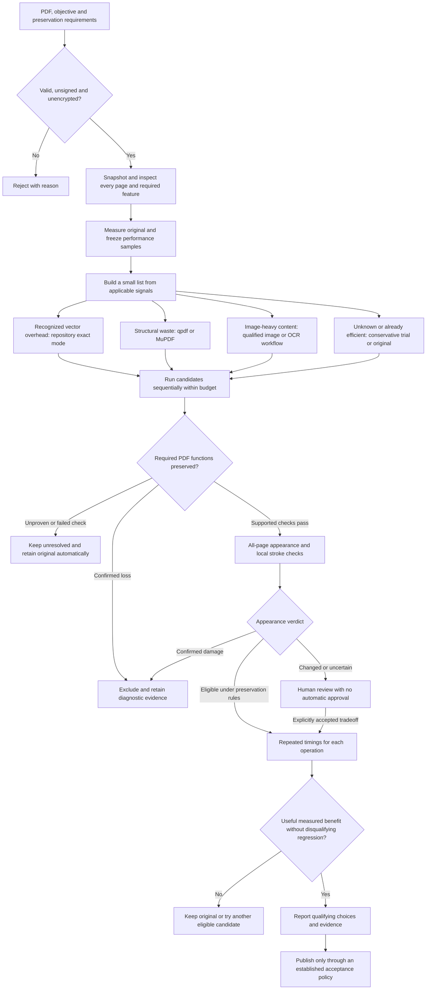

# Main improvement plan: adaptive optimizer selection

**Status: active, primary roadmap. Adopted 2026-10-18.** Start future improvement
work here. This is the maintained plan for the next iteration; it supersedes the
old comparison handoff as a work queue. Update this file when priorities change
instead of creating a competing plan.

The goal is to select a small set of PDF optimizers from the source's actual
structure and the user's objective, then verify which results are useful.
**File characteristics select candidates; preservation and measurements select
outputs.** Expected benefits are hypotheses until measured.

This document describes completed and planned work. Current production behavior and acceptance
rules remain in [design.md](design.md). The existing exhaustive comparison runner
is documented in [comparison.md](comparison.md). The companion classifier/planner
does not replace the production acceptance path; production exact checkpoint reuse
and batch restart recovery are implemented as described under P11.

## Current foundation and immediate priority

**Next action (2026-11-04): continue P13/P14 through code and automated validation;
Computer Use is excluded by user instruction. Native P13 qualification is deferred
and P14 real-document holdout acceptance remains open. Scoped batching and source
browser viability are implemented and generated-fixture qualified below.
P15 is release-qualified.** Preserve the existing milestone numbers and
completed history.
The objective remains smaller, efficiently rendered copies without sacrificing
required content; these repairs make preservation and selection evidence reliable.

**Next queued initiative: [P16 — approximate handwriting research](#p16-approximate-handwriting-research-and-conditional-product-option).**
The user has requested a procedure for testing bounded point reduction and curve
optimization while protecting small writing. P16-A repairs the legacy transparency
gap before experimental rewriting; P16-B through P16-E establish eligibility,
quality checks and measured benefit. Curve fitting and a public option are
conditional follow-ups. Existing P13/P14 qualification remains open as recorded;
this plan neither completes it nor changes current exact-mode acceptance.

**Additional research option: [P17 — notes to LaTeX study copies](#p17-notes-to-latex-study-copy-research).**
Investigate the local `pdf-text-extractor` companion as an ingestion/UI starting
point for editable `.tex` plus a compiled PDF. This is content transcription and
retypesetting, with its own review contract; it cannot qualify as an exact viewing
copy or a P16 geometry-preserving treatment. P17 research may proceed independently
of P16, without displacing the current direct-mode and P13/P14 qualification work.

**Current priority (corrected 2026-11-02): direct viewing copies.** Keep useful
transformations and comparable storage savings while removing exhaustive optimizer
comparisons and rendering-speed benchmarks from routine jobs. Thirty seconds on a
short document is aspirational, not a required benchmark or reason to discard
inlining, deduplication or cleanup. Follow [quick-lossless-plan.md](quick-lossless-plan.md)
before speculative adaptive selection. The default direct chain retains those
transformations, packs once and verifies preservation. The earlier compression-only
lane remains an explicit qpdf option. [design.md](design.md) defines both profiles;
thorough gates remain unchanged. Fresh generated matrix and interaction fixtures
pass the native-browser harness, and P15's native two-file GUI/release checks are
complete.

The maintained implementation already includes:

- Production viewing-copy generation and its existing preservation/performance
  gates, plus the legacy CLI/Python modes.
- A separate fixed-profile comparison runner with independent function/appearance
  checks, native Firefox measurements, visual evidence and reports.
- Comparison progress logs and heartbeats, real canvas/detail zoom completion
  tracking, and append-only per-operation records. Those research-run records do
  not provide automatic resume.
- Separate PDF-function and source-image-region findings, alongside descriptive
  missing/added ink, displacement, thickness and topology measurements.

**P12 is complete.** The Windows workflow now has keyboard-complete review and
controls, startup dependency diagnostics, clean setup/package verification and a
human-visible two-fixture acceptance run. Future work should begin with new measured
evidence rather than extending this delivery plan speculatively.
The architectural boundary is recorded in
[ADR-001](adr-batch-workflow.md); this roadmap remains the ordered work queue.

Run progress belongs in ignored `audit-output/`, not in this roadmap. Consult the
relevant run's completed records, final status, hashes and report for current
facts; do not infer completion from an older chat or partial assessment. Keep
private files, paths, screenshots and detailed comparison reports out of commits.
Do not change the running implementation during an active comparison.

## Fresh-agent handoff for P16/P17

An agent can start these tracks without the preceding chat. Read `AGENTS.md`,
this roadmap's current-priority paragraph and relevant P16/P17 phases, then
[design.md](design.md), [testing.md](testing.md), and
[comparison.md](comparison.md#read-the-evidence) before changing transformations
or collecting research measurements. P16/P17 are plans, not shipped capabilities.
P16-A's legacy opacity repair remains required until its stated exit is proved;
P17's source inspection and compiler probes did not run recognition or compile notes.

### Locate inputs and establish the current checkout

1. Read the actual working-tree diff and check for active optimizer/comparison
   processes before touching executable files. Preserve pre-existing edits;
   historical test counts and roadmap notes do not establish this checkout's
   status. Identify a running job's owned source/code context rather than assuming
   that a readable PDF or an old `running` note proves current activity.
2. On the original machine, optional local resource locations are in
   `audit-output/research-handoff.local.json`. It records the caller-selected
   `pdf-text-extractor` directory, local generated reproduction evidence and source
   hashes. Read it as a locator, recheck files/hashes, and keep it ignored. It is
   not portable authorization or a current run verdict. Do not copy its machine
   paths or detailed reports into tracked documentation.
3. If that index or the companion checkout is absent, use the portable P16-A recipe
   below and the pinned P17-B upstream links. Request the companion location only
   when work actually needs it; independent generated tests and upstream inspection
   can proceed. Follow the companion's applicable instructions and filesystem
   permissions before editing it. No change to that other repository is implied
   by this optimizer roadmap.
4. Use the repository virtual environment and pinned dependencies described in
   README. Resolve browser/Node/qpdf/TeX tools in the current environment; do not
   copy paths or assume that a previous compiler version probe tested packages,
   model hardware, safe execution or a working notebook conversion.

### First bounded deliverable by requested track

| Request being continued | First deliverable | Stop/advance condition |
| --- | --- | --- |
| Existing optimizer/direct-mode work | Follow the current P13/P14 priority and inspect their actual outstanding evidence | Do not replace these tasks with a new feature just because P16/P17 appear later in the roadmap |
| Approximate coordinate/point-reduction work | P16-A: reconstruct the inherited-mask case, add a failing regression, repair the shared eligibility boundary | Focused and full tests pass and the altered transparent result cannot publish; then begin P16-B/C before the simplifier |
| Notes-to-LaTeX research | P17-A/B: inspect the companion, write the transcription contract, and qualify one recognition backend on generated/reference cases | Preserve source coverage and distinguish recognizer output from a compiling skeleton; a known-source TeX smoke under P17-D may be developed independently |
| Public experimental option | Implement the relevant qualified research treatment first | P16-G or P17-F is conditional; no new public mode or automatic default is needed to start research |

For P16-A, the existing focused tests can be run from the root with
`.\.venv\Scripts\python.exe -m unittest discover -s tests -p 'test_*handwriting.py'`;
extend these with the new regression, then use the full-suite and compatibility
commands under [P16 execution](#p16-execution-commands-and-evidence-basis).

### Decisions deliberately left open

- The exact simplifier/parser implementation, its independently checked bound,
  protected-feature detector and calibrated safe tolerance remain P16 research.
  The numerical ladder in P16-C is experimental input, not a released preset.
- P17 has no selected or benchmark-qualified model. An agent may choose one pilot
  backend after inspecting available hardware and its model/code terms, testing
  generated/reference inputs and recording requirements. Do not infer cloud or
  paid-service authorization from an upstream example or from this roadmap.
- Public option names, final manifest/report schemas and companion-versus-adapter
  ownership are settled at their implementation gates. Keep one maintained
  implementation; a backend choice does not require adopting its whole UI/stack.
- Personal holdouts and review decisions need explicit input identity and applicable
  task authorization; an old dated holdout reference is not a new input selection.
  The plans do not promise that private corpus files exist in this checkout.
- Unavailable native measurements and deferred native GUI qualification remain
  pending. Continue independent code/generated work without treating them as passes
  or requesting Computer Use that the current instructions exclude.

At minimum, a research record must identify its track/phase, source/baseline/output
hashes, treatment, code/tool/model/prompt/policy identities, settings/units,
page/region coverage, completed checks and raw timing references, review state,
terminal outcome and unresolved limitations. P17 adds block-to-source anchors and
`.tex`/asset/build identities. A completion marker comes after its payload; a partial
record, missing metric or absent review cannot become an accepted result.

The existing comparison runner has a closed `PROFILES` registry and validates
tool/profile imports. An agent cannot enable a new simplifier or retypesetter by
inventing a profile in local configuration. Implement and test the research adapter
and its supported configuration, or use a deliberately scoped research harness,
before documenting its commands. Reflowed P17 content needs its own mapping-based
evaluation; do not substitute it into the runner's current page-equality checks.

## P15: repair the six confirmed audit findings

**Status: completed and release-qualified 2026-11-04.** The
[implementation walkthrough](audit-repair-walkthrough.md) covers
incremental trailer precedence, inline signature widgets, skipped retry recovery
and the setup keyboard race. Its four finding numbers are from the second audit.
The numbers below retain the original audit finding
numbers; execution order is 1, 2, 4, 3, 5, 6. Keep private reproduction files and
document-specific results in ignored `audit-output/`. Use generated fixtures for
committed regressions. Before executable changes, check for an active comparison
and preserve the current uncommitted work. No new dependencies or optimizer modes
are needed.

### P15-A — Preserve custom trailer data (finding 1)

- Extend the shared preservation check in `navigation.py` to include non-storage
  trailer entries, including entries in cross-reference streams that pypdf omits
  from its public trailer. Reuse the storage exceptions in `lossless_verify.py`;
  do not mistake file-layout changes for document-data changes.
- Trace `navigation_fingerprint` callers in legacy, direct, thorough and companion
  paths. If writer cloning drops an unsupported entry, reject that candidate;
  do not add speculative reconstruction logic or accept the loss to obtain savings.
- Add generated classic-trailer and cross-reference-stream cases with direct and
  indirect custom values. An unchanged value must pass; deletion/mutation must
  fail. Exercise the direct publication path and retain ordinary bookmark, link,
  layer and attachment coverage. Update affected verification/cache identities.
- **Done when:** no output can be published with missing custom trailer data,
  while supported storage-only changes and ordinary inputs still pass.

### P15-B — Reject all signature objects before cleanup (finding 2)

- Reuse one signature predicate across input validation and the strict comparator.
  Inspect the bounded current object inventory, including unreferenced objects and
  objects inside object streams, before transformations can remove them. Do not
  decode unrelated image/content streams just to inspect dictionary keys.
- Cover the shared `validate_input` callers and `validate_quick_input`, retaining
  encryption, field/widget, parser-warning and unresolved-reference safeguards.
  Fail closed when the inventory cannot be inspected within its limits.
- Add orphan `/Sig`, orphan signature-field and `/ByteRange` plus `/Contents`
  cases, including compressed-object storage. Assert that direct, compression-only
  and shared legacy/thorough entry points reject them before generating a copy;
  ordinary unsigned input must remain accepted.
- **Done when:** cleanup cannot conceal a signature from validation, originals
  remain intact, and no candidate is published for these inputs.

### P15-C — Bind timing reuse to the actual renderer (finding 4)

- Retain the PDF.js preflight result in `viewing_copy.py` and include its version
  and module hashes in the existing timing context. Keep Node, source/candidate,
  settings and code identities; entries lacking the new identity must miss.
- Extend resume tests: identical context reuses timing; changing the actual
  renderer through `PDF_NODE_MODULES` invalidates timing even with the same Node
  executable and repository lockfile. Final acceptance/publication must still run.
- **Done when:** a resumed speed classification cannot use another renderer's
  measurements. Direct mode remains explicit that viewing speed is not measured.

### P15-D — Recover retryable batch jobs (finding 3)

- Update `_recover_job` and cancellation handling in `batch_workflow.py` so a
  timeout or disk-budget interruption can recover the same reviewed output and
  checkpoint. Canceling review of an interrupted job must not erase recoverability.
  Define eligible states explicitly; do not indiscriminately retry every failure.
- Retain source/profile/optimizer identity checks, owned-process claims, report
  validation and output collision refusal. Thorough mode reuses only validated
  completed stages; interrupted direct mode restarts its pass as currently designed.
- Test timeout and budget exhaustion followed by reselection, interrupted-job
  review cancellation followed by reselection, and refusal after source/profile
  changes or output collisions. Align user messages with what can actually resume.
- **Done when:** eligible retries reuse their original run folder without replacing
  existing artifacts or reusing invalid evidence.

### P15-E — Validate completed companion results on resume (finding 5)

- Remove the unchecked completed-result return in `tools/run_optimization_plan.py`.
  Before returning success, validate the saved source and retained candidate files
  against recorded hashes, reusing the existing checks for incomplete resumes.
- Reject missing/changed artifacts with a clear reason; do not silently replace
  them or claim integrity from a saved boolean. Keep reports-only candidate states
  valid where no output was expected.
- Add completed-resume cases for unchanged files, deleted/changed source snapshots,
  deleted/changed candidates and missing hash evidence.
- **Done when:** a completed result is returned only for artifacts whose existence
  and identity have just been verified.

### P15-F — Keep setup and selection responsive (finding 6)

- Move dependency diagnostics and batch planning out of Tk callbacks in
  `viewing_copy_gui.py`, using its existing worker/event-queue pattern. Keep file
  pickers, review dialogs and every widget update on the UI thread. Add only the
  minimal optional planning progress callback needed to identify the current file.
- Snapshot selected settings, disable conflicting controls, restore them after
  failures, and ignore late worker results after closing the window. Never start
  an optimizer before review approval; keep active-job stop/close semantics.
- Test with deliberately blocked diagnostics/planning: UI event polling must
  continue, close must remain safe, exceptions must restore controls, and stale
  results must not enable processing under the wrong profile. Check keyboard
  operation and the two-file review flow in the native Windows UI.
- **Done when:** slow setup or file inspection leaves the window responsive and
  cannot bypass review or launch duplicate jobs.

### P15 integration and release gate

After each repair, run its focused regression tests. After integration, run Ruff
and the full unittest suite with writable local temporary storage. Follow
[testing.md](testing.md) for fresh generated direct/thorough compatibility fixtures,
all-page rendering and browser interaction checks affected by preservation changes.
Record browser checks as pending if native startup is unavailable.

Keep geometry, text, image, navigation, appearance and performance thresholds
unchanged. Invalidate saved evidence when its acceptance rules change. Verify that
unsigned supported fixtures still produce useful smaller copies where applicable;
reports-only rejection is the correct outcome when preservation is unresolved.
Do not infer rendering gains from storage savings or overlap timing with heavy work.

Align README/setup messages, tests and packaging only where behavior changes. Build
into a fresh release destination and verify packaged runtime bytes and a generated
fixture smoke run. Keep private PDFs out of fixtures and commits; additional real
document optimization requires authorization beyond the earlier read-only inspection.
Close P15 only after all six exit criteria and required release checks have evidence.

### P15 implementation notes — 2026-11-03

- `navigation.py` now retains custom classic/xref-stream trailer entries in the
  shared fingerprint and inventories up to 500,000 current objects before any
  cleanup. One signature predicate rejects orphan `/Sig`, signature fields and
  `/ByteRange` plus `/Contents`, including objects stored in object streams.
- Thorough timing cache identity now contains the PDF.js version and loaded module
  hashes returned by preflight. Direct mode remains benchmark-free. Timeout and
  disk-budget batch records are explicitly retryable at the same reviewed output;
  canceling their review no longer overwrites the recoverable record.
- Completed companion results re-hash `source.pdf` and every retained candidate
  before returning. Missing, changed or hashless artifacts fail closed. GUI setup
  diagnostics and batch planning now run off the Tk thread with snapshotted settings,
  progress events, stale-result rejection and safe close handling.
- Ruff passes. All 210 regression tests pass; one directory-symlink test is skipped
  where Windows denies creating that fixture. Fresh 27-page and interaction fixtures
  passed direct PDFium/PDF.js render checks and isolated Firefox/Zen browser checks.
  The fresh release verified 54 ZIP members and 31 installed-skill files byte-for-byte;
  its packaged optimizer published a smaller verified interaction-fixture copy.
- Native startup, background setup completion and Alt+P system-picker opening/cancel
  passed. The automation helper could not reliably target the multi-select filename
  control, so the required two-file review-dialog smoke was not completed. Keep P15
  open until that generated-fixture UI check is observed; no real/private PDF was used.

### P15 follow-up audit repair notes — 2026-11-03

- `_PreservingReader` now merges permitted xref-stream trailer entries into the
  public trailer as each revision is parsed, so newest stream values survive older
  stream and classic revisions. `test_newest_incremental_xref_stream_trailer_wins`
  covers two appended revisions, mixed classic/stream precedence, qpdf validity and
  rejection when writer cloning would drop the custom entry.
- Shared input validation again walks direct page widgets and bounded parent chains
  while retaining the current-object inventory. The direct widget, direct signed
  parent, legacy optimizer and direct-profile rejection paths are covered by
  `test_direct_signature_widgets_and_parents_are_rejected`; the separate cycle test
  proves malformed parents terminate.
- Skipping a queued recovered retry no longer replaces its saved timeout or
  disk-budget record. `test_stop_and_close_preserve_retry_checkpoint` covers both
  statuses and both stop/close paths with zero child launches and stable output and
  checkpoint paths.
- Setup now returns before changing state when the window is closed, optimization is
  running or the setup control is disabled; root Alt+S invokes only the enabled
  button. The blocked-planning GUI regression proves the original review callback
  still runs exactly once and no optimizer launches after review cancellation.
- Focused navigation, GUI/batch and direct-profile suites passed 9, 29 and 31 tests;
  the GUI suite had one Windows symlink-permission skip. Ruff and all 213 regression
  tests passed with the same single skip. Fresh direct fixtures passed 27-page and
  interaction PDFium/PDF.js rendering plus isolated-browser checks. Fresh thorough
  fixtures passed renderer checks, but the interaction browser check timed out after
  a page-2 annotation navigation landed on page 3; no gate was relaxed or bypassed.
- Windows automation was not approved to attach to the launched GUI, so the native
  two-file picker/review/start/stop smoke remains pending. No release package was
  built because P15 is not release-ready. Only generated PDFs under ignored
  `audit-output/` were exercised; no original/private PDF or existing output changed.

### P15 completion notes — 2026-11-04

- The thorough-browser timeout reproduced as delayed PDF.js `/XYZ` destination
  reflow after the target had first become visible. `settled()` now permits at most
  two measured corrections only after observing the requested target, normalizes
  `/XYZ` position with PDF.js's own viewport conversion and still requires complete
  rendering, text/annotation layers, 100 ms stability and exact source/candidate
  viewport equality. Fresh direct and thorough 27-page matrix and three-page
  interaction fixtures passed PDFium/PDF.js rendering and isolated-browser checks.
- The native Windows GUI selected two generated PDFs in one system picker, displayed
  both source/output mappings, ran them sequentially and reached 2/2 with one
  hash-valid optimized result and one honest no-improvement result. A second two-file
  run used the review Alt+S binding and main-window Alt+T while file 1 was active;
  the terminal summary was exactly one optimized and one skipped, with no second
  child launch.
- Ruff and all 213 regression tests pass; one directory-symlink test is skipped where
  Windows denies creating that fixture. Three GUI-produced reports matched their
  published output hashes or reports-only state. The final release builder verified
  55 ZIP members and 31 installed-skill runtime files byte-for-byte.
- A clean extracted ZIP created its private environment, installed pinned Python and
  PDF.js dependencies, reported zero npm vulnerabilities and published a smaller
  generated interaction-fixture copy with matching report/output SHA-256 and complete
  all-page PDFium/PDF.js verification. No private PDF was used, no original was
  modified, and no acceptance threshold or public interface was relaxed.

## P16: approximate handwriting research and conditional product option

**Status: planned; procedure adopted 2026-11-04.** No point simplifier, curve fitter
or approximate public option is implemented by this roadmap update. The hypothesis
is that removing redundant path segments can improve first rendering and redraws
beyond exact inlining/packing. Point-count reduction, smaller bytes and fewer PDF
commands are explanatory measurements, not evidence of a rendering speedup.

Execute P16-A through P16-E in order. P16-F is conditional on the measured limits
of point reduction; P16-G requires a useful, qualified treatment from P16-E or
P16-F. P16-H lists later extensions with explicit entry conditions. P13/P14's
applicable state/resource and automated acceptance checks are prerequisites for
reuse; deferred native qualification remains deferred, never an inferred pass.
Do not add these features to routine direct jobs while research is incomplete.

### P16 scope, ownership and evidence

- Preserve the current CLI/API, exact/default modes and their acceptance rules.
  Approximate research gets a distinct transformation and quality-policy identity;
  a future supported option requires the separate design change in P16-G.
- No handwriting rasterization, OCR removal, image resampling, text rewriting or
  general PDF regeneration. Navigation, hit areas, labels, attachments, images,
  fonts, retained interactive identities, layers and non-target drawing data keep
  their existing preservation requirements. Never overwrite originals or reports.
- Research artifacts stay in fresh ignored `audit-output/` directories. Record
  source/baseline/candidate SHA-256, recipe and code hashes, versions, tolerances,
  renderer settings, hardware, coverage, raw observations and terminal status.
  Review decisions bind those identities; changing any candidate invalidates them.
- Do generated work first. Real PDFs require authorization for the specific input
  and run one document at a time. Use disposable browser profiles and owned-process
  cleanup; no Computer Use is required by this procedure. Check for active
  comparisons before changing executable code and preserve unrelated dirty work.
  Use a suitable existing checkout; a separate development branch may be named
  `codex/approximate-handwriting`, without copying the maintained implementation.
- Benchmarks, image analysis and other heavy checks run in separate phases.
  Missing dependencies, unresolved content, zero-resolution timers, failed checks
  and interrupted work retain explicit unavailable/unproven states.

| Maintained area | Planned responsibility; existing mechanisms to reuse |
| --- | --- |
| `handwriting.py`, `annotation_ink.py` | Shared opacity/eligibility proof, supported path parsing, explicit experimental transform; retain annotation safeguards |
| `geometry.py`, `navigation.py`, `lossless_verify.py` | Existing exact checks remain intact; independently check declared approximate edits and exact unaffected structures |
| `tools/pdf_characterize.py`, `tools/plan_optimization.py` | Count eligible geometry and explain skip reasons; do not automatically recommend a new family before qualification |
| `tools/compare_optimizers.py`, `tools/firefox_measure.py`, `pdfjs_benchmark.mjs` | Research-only candidate adapter, sequential measurements, true native redraw evidence and versioned records |
| `tools/comparison_metrics.py`, `tools/feature_loss.py` | Local displacement, width, topology, color and feature findings; no aggregate semantic-safety score |
| `tests/`, compatibility runners | Generated geometry, small-writing, negative-control and integration fixtures; all-page renderer checks |
| `optimize_pdf.py`, `viewing_copy.py`, `quick_lossless.py` | Public integration only at P16-G; never route approximate output through an exact manifest or relax an existing comparator |
| `batch_workflow.py`, `viewing_copy_gui.py`, release builder and documentation | Explicit future mode/review, recovery isolation, packaging and accurate user-facing claims |

Prefer existing helpers and dependencies. A separate root transformation module
is justified only if the prototype cannot remain clear beside the supported
handwriting code. The table names affected areas, not a requirement to edit every
file or build a new framework.

### P16-A — Close the legacy opacity gap

1. Trace all callers of `rewrite_handwriting`. Viewing-copy batching supplies the
   scoped `batching_contexts` eligibility set; legacy `--fast-handwriting` currently
   calls it without that proof. Reuse the shared proof for the legacy route, with
   conservative handling of duplicate-layer removal and unsupported Forms.
2. Commit a generated regression with crossing strokes under an inherited soft
   mask. It must establish that the legacy whole-page peak/mean guard can miss an
   interior compositing change, and that the repaired route leaves unsafe strokes
   unchanged or rejects the job before publication. Exercise both CLI/API callers.
3. Cover shared safe/unsafe Forms, groups, blend modes, both alpha values,
   overprint, state resets and mask/annotation/font/pattern resource references.
   Unrelated proven opaque Forms must remain eligible. Keep exact inlining
   distinct from stroke merging; do not disable it merely because batching skips.

**Exit:** focused tests and the full suite pass; the counterexample cannot publish
the altered transparency; originals, shared resources, existing callers and
output cleanup remain intact. Repairing this gate is independent of whether P16's
approximate experiment succeeds.

**Portable reconstruction recipe:** reuse `make_boox` from
`tests/test_handwriting.py` to obtain a 200-by-200-point page and its `/FFT0` Form.
Retain that Form's recognized opaque local `/GS` state and `HEADER`, but replace
its body with these two separately painted round-capped strokes:

```text
10 w 20 20 m 80 80 l S
10 w 20 80 m 80 20 l S
```

Add a separate mask Form with `/BBox [0 0 200 200]`, an empty resource dictionary,
`/Group << /S /Transparency /CS /DeviceGray /I true >>`, and body
`0.5 g 0 0 200 200 re f`. Reference it through a page ExtGState named `/Masked`
whose `/SMask` is `<< /S /Luminosity /G MASK_FORM_REFERENCE >>`. Set page content
to `q /Masked gs /FFT0 Do Q`; do not retain `make_boox`'s duplicate-layer page
commands or add a local `/SMask /None` reset to the pen Form. Write/reload the PDF.

Before repair, legacy `optimize(..., fast_handwriting=True)` batches the crossing
and can publish a lighter interior intersection; its whole-page peak/mean guard
does not check the edge band. The scoped proof must report inherited `/SMask`,
and viewing-copy batching must leave it unchanged or reject it. Check PDFium and
PDF.js for interior differences, then assert the repaired legacy route cannot
publish them. Avoid fixed pixel-count assertions tied to one renderer version.
This fixture is generated and needs no original personal PDF or chat attachment.

### P16-B — Freeze the experiment and identify real opportunities

1. Inventory generated sources with the existing characterizer. Separate
   multi-vertex stroked paths, separately painted two-point segments, curves,
   variable-width runs, filled outlines, image stamps, annotations and raster
   content. Record reachable invocation counts, decoded path bytes, point/segment
   counts, paint calls, local widths, transforms and opacity skip reasons.
2. Define the first supported subset: recognized opaque positive constant-width drawing
   runs with resolvable resources, transforms, clipping and paint order. Keep
   device-dependent hairlines, variable widths, filled outlines, live annotation
   rewriting and unresolved structures unchanged. A document with no supported opportunity reports that
   result before expensive candidate rendering.
3. For each document, freeze its immutable original and best fully verified exact
   baseline; use the original if no exact candidate qualifies. Verify the baseline
   under its own existing policy. Record all eligible exact baselines and selection
   rules so choosing a weak comparator cannot manufacture an improvement.
4. Freeze the treatment table below, quality policy, target viewing operation,
   renderer versions, viewport/device scale, sample pages, tolerance ladder and
   run budget before inspecting candidate timings. Characterize every page; timing
   samples include page 1, source-only slow/dense pages and representative small
   writing. Do not choose pages from candidate results.

| Treatment | Purpose |
| --- | --- |
| Original | Source reference and absolute behavior |
| Best accepted exact copy | Primary incremental-benefit comparator |
| Existing opacity-qualified batching | Distinguish paint-call savings from point reduction |
| Zero-tolerance experimental control | Prove the new path is a no-op when no reduction is requested |
| Point reduction alone | Isolate fewer vertices from other transformations |
| Point reduction plus qualified batching | Measure the combination, with the same packing settings |
| Curve fitting, only after P16-F opens | Determine whether fewer curve commands actually beat line reduction |

Generate each treatment from the immutable source using its declared recipe; do
not repeatedly simplify a previous approximate output. Record packing separately
and hold it constant across comparable treatments. Existing experimental/legacy
output is a comparator, never an assumed quality-approved baseline.

**Exit:** a versioned experiment manifest and an opportunity report explain every
planned treatment, page, bound and skip. No-op, already-efficient, raster-only and
unsupported inputs are represented, not silently removed from the denominator.

### P16-C — Calibrate preservation of small writing before simplifying it

1. Generate deterministic paths with known dimensions and expected topology:
   straight oversampled lines; smooth arcs; cusps; open/closed loops; self-crossings;
   narrow gaps; touching strokes; short pen lifts; zero-length dots; repeated points;
   and widths spanning the supported range. Include dense and already-minimal cases.
2. Add text-like and mathematical groups at several physical sizes: `e/c`, `o/c`,
   `1/l`, `rn/m`, decimals, primes, accents, subscripts, exponents, minus/equality
   signs, fraction bars, arrows and small looped letters. Treat these as labelled
   shape controls, not an OCR-based guarantee about arbitrary handwriting.
3. Exercise translation/scaling, rotation, shear, page boxes, `UserUnit`, clipped
   extents, optional layers, shared calls and mixed image/text/OCR pages. Unsupported
   transforms must skip explicitly rather than misapply a tolerance. Add resource
   cycles, malformed paths, signatures, encrypted inputs and publication races.
4. Build deliberately damaged controls: delete a decimal or short bar, open/close a
   loop, join letters, break a stroke, move a superscript, thin/thicken ink, fade a
   color and alter mask overlap. The checker must detect the labelled failures.
   Exact structural rewrites and zero-tolerance controls must remain accepted.
5. Reuse the existing local foreground metrics at all supported thresholds. Record
   physical-unit displacement, width changes, matched coverage, missing/added
   components, loops and joins, color/contrast and raster quantization. Foreground
   is not automatically handwriting-only. The existing 0.1 mm skeleton matching
   radius is a measurement parameter, not an acceptance tolerance.
6. Select a small research ladder, initially zero, 0.01, 0.025 and 0.05 mm maximum
   path deviation, further capped at 10% of the local minimum stroke width and
   relevant gap. These are proposed calibration inputs, not validated safe presets.
   Convert through page units and every invocation transform. If width, gap,
   visibility or a conservative bound cannot be established, preserve that run.
   Freeze the resulting policy before held-out testing; do not tune on failures.

**Exit:** known harmful controls are rejected, exact controls pass and unresolved
cases are exposed. Every supported tolerance has documented limits. Whole-page
similarity, OCR agreement, average displacement and point counts cannot certify
that small letters or mathematical meaning stayed the same.

### P16-D — Implement bounded point reduction as a research treatment

1. Start with redundant-point removal on supported constant-width line paths using
   an error-bounded polyline algorithm. Preserve endpoints, closure/winding,
   protected corners/cusps, dots, tiny components, crossings, narrow loop necks,
   width changes and disjoint subpaths. Skip ambiguous regions instead of inventing
   a pen-up, pressure or stroke identity from matching endpoints alone.
2. Distinguish paths already painted as one connected stroke from BOOX exports
   composed of separately capped/painted segments. First implement the former.
   Reconstruct the latter only as a separately labelled treatment after proving
   its supported grammar/continuity and bounding its actual stroked envelope,
   including caps and joins. If no safe reconstruction is established, report no
   opportunity for those exports; do not silently join segments to force a gain.
3. Keep literal retained coordinates and widths; do not add global coordinate
   rounding or pressure averaging. Copy resources before editing, retain external
   drawing/layer order and preserve clipping. A Form shared with any unsafe context
   stays unchanged in this first version; cloning is deferred to P16-H.
4. Write a manifest for each changed run: source/output body hashes, resource and
   invocation identities, original/result point and paint counts, protected indices,
   tolerance/units, algorithm version and claimed error bound. Record skipped runs
   and reasons. Read the saved PDF back; in-memory counts are insufficient.
5. Verify independently from saved source/output paths. Bound deviation in both
   directions, check stroke envelopes/caps/joins and preserved topology, and
   compare unaffected drawing/resource graphs and PDF functions exactly. Do not
   reuse the simplifier's own decision as its proof, blanket-ignore changed Forms,
   normalize approximate geometry as exact, or call dense sampling a certified
   continuous-path bound. Unproved bounds make a treatment ineligible.
6. Test deterministic output, tolerance boundaries, transformed/shared invocations,
   bounded work, no-op behavior, parser errors, interrupted writes and changed-source
   rejection. The zero-tolerance control leaves target path bytes unchanged. Keep
   the new treatment in the research adapter; no public flag is required yet.

**Exit:** generated positive cases remove points within the independent bound;
negative cases retain protected features or fail closed. Existing exact-mode tests
still pass without altered thresholds. Fewer vertices are not yet a speed claim.

### P16-E — Run the quality/performance experiment and decide whether to proceed

1. Run focused regressions, then the full suite and existing exact/direct generated
   compatibility checks. Produce fresh experimental fixtures and completion records.
   New experimental runner stages must be implemented and documented before their
   commands are presented as runnable; existing runners do not test simplification.
2. Do a structural/syntax screen and coarse all-page appearance/feature check before
   timing. Then release all readers/workers. Measure qualified treatments sequentially
   before expensive crop/metric analysis, avoiding concurrent heavy work. Finish
   full quality evaluation before issuing any recommendation.
3. Measure standalone PDF.js operator preparation, cold-render CPU/wall time and
   cached drawing separately. Use fresh processes and alternating/rotating treatment
   order; three repetitions extend to five for noisy or close results. Never add
   preparation and cold-render timings or include optimization/verification time as
   viewing latency. Retain startup/load and optimization costs separately.
4. Use the native Firefox protocol in [comparison.md](comparison.md#read-the-evidence)
   for first visible render, cached page revisits and real page-width/100%/200%
   canvas/detail redraws. Freeze hardware, browser/viewer identity and preferences.
   CSS-scaled previews, no-op zooms and readiness polling are not completed redraw
   timings. Native unavailability stays unavailable; standalone PDF.js cannot
   establish a native-viewer result. Record sampled process-tree RSS as sampled
   memory, not peak memory.
5. On every changed page, compare PDFium at 144/288 DPI and PDF.js at width 1404.
   Add print checks and true 576-DPI crops for every flagged/protected small-writing
   region, plus predetermined unflagged controls. Compare in source coordinates
   without alignment/warping, across the normal zoom range; record background and
   alpha settings. Keep current exact gates for unchanged pages/structures. The
   approximate policy is distinct from today's one-pixel edge-shading guard.
6. Index all changed pages and flagged regions with source/candidate views, overlays,
   local metrics and review status. A reviewer checks every changed page at readable
   zoom, all small/protected marks and flagged crops. Missing coverage or ambiguous
   writing stays unproven. Human review of changed writing is required for research
   acceptance; no language model, OCR score or aggregate metric replaces it.
7. After generated calibration, freeze the implementation/policy and test authorized
   whole-document holdouts not used for tuning. Include dense notes with small math,
   mixed/raster-heavy pages, shared resources and a low-opportunity control where
   available. Report unavailable categories rather than fabricating corpus coverage.
   A failed holdout returns to implementation and requires a new untuned holdout;
   it must not be turned into a successful run by loosening its limits.

**Planned go/no-go criteria:** quality and independent non-target preservation must
pass before performance matters. Require at least 10% lower aggregate median
cold-render CPU than the best accepted exact baseline, plus at least 10% and 50 ms
lower median latency for the preregistered slow native viewing operation. Retain
the existing no-regression limit (the greater of 10% or 50 ms) on each sampled
cold/cached/zoom latency against both source and exact baseline. Show raw runs and
uncertainty; unresolved timer/noise or missing native evidence cannot qualify.
These are proposed P16 experiment gates, not changes to production selection.

**Exit:** a completed, hash-bound report labels each treatment useful, no worthwhile
gain, quality failure or unproven/unavailable. Report worst pages, eligible/changed/
skipped coverage, point/paint changes, bytes, CPU, each latency operation, sampled
memory and reviewer findings separately. An approximate copy that only saves bytes
does not justify a rendering feature. If no treatment qualifies, close the experiment
with that result and retain the exact path; do not build a public option by default.

### P16-F — Conditional curve fitting

Open this work only if P16-E shows that supported path processing remains material
and an opportunity remains after line reduction. Fit bounded curves to eligible
opaque runs, preserve the same protected features and independently verify the
continuous geometry/stroked envelope. Curves are subdivided by renderers, so fewer
PDF commands alone do not establish reduced rasterization work. Repeat the full
P16-C/E controls, measuring against point reduction as well as the exact baseline.
Do not add curve fitting if it offers no repeatable incremental viewing benefit.

**Exit:** an independently checked curve treatment clears the same quality and
performance gates, or is explicitly deferred/rejected with its limiting evidence.

### P16-G — Conditional opt-in product integration and delivery

1. Before changing product behavior, specify the separate approximate contract in
   [design.md](design.md): supported content, calibrated limits, required human
   review, unavailable/unproven states, performance gates and publication policy.
   The initial contract requires hash-bound review of changed writing before
   publication; automate approval only after a separately justified future policy.
2. Add one explicit experimental selection through the existing CLI/API and reviewed
   batch plan. Preserve defaults and old caller signatures; reject incompatible
   combinations. Keep tolerance presets limited to qualified values. Distinguish
   generation of private research artifacts from publishing a reviewed viewing copy;
   unresolved quality produces reports only and retains the original/exact baseline.
3. Version recipe/checkpoint/report contexts with algorithm, tolerance, baseline,
   quality-policy, reviewer decision and renderer identities. Prove that approximate
   artifacts cannot satisfy exact-mode recovery or reuse another tolerance's review.
   Final source/output hashes, browser/function checks and exclusive publication
   remain mandatory. Browser appearance evidence must explicitly use the new policy
   while navigation/interactions retain exact checks; do not weaken shared checks.
4. Exercise API/CLI compatibility, batch failure isolation, cancellation, recovery,
   missing dependencies, source mutations, collisions, cleanup and reports-only
   outcomes. Align the new mode's scope in AGENTS.md and README, relevant launchers/
   GUI labels, tests, fixture runners and release packaging together while retaining
   the exact-mode rules. Disclose modified geometry and reviewed coverage;
   do not describe approximate output as lossless or universally word-preserving.
5. Run the full suite, new calibrated fixture matrix, all-page/print/detail/function
   and code-driven browser checks, then a fresh authorized holdout. Package to a new
   destination with the existing builder, verify maintained-source/ZIP/skill bytes,
   and test a clean extracted install. Honor any still-deferred native GUI work;
   list it as pending rather than substituting generated render success.

**Exit:** a supported, explicit option has a documented preservation/review contract,
repeatable measured benefit, isolated recovery, verified packaging and honest limits.
Do not promote it to a default as part of P16.

### P16-H — Additional features, only when evidence identifies a remaining cost

| Deferred feature | Entry condition and required additional tests |
| --- | --- |
| Per-invocation Form cloning | Shared safe/unsafe Forms exclude material opportunities; prove copy-on-write resource identity, unchanged unsafe invocations, clipping/layers and bounded size growth |
| Variable-width / pressure-aware reduction | Constant-width treatment leaves a measured bottleneck; independently bound the full width envelope, pressure extrema, dots and joins without averaging away features |
| Filled-outline simplification | Outline-heavy supported files remain slow; preserve winding, holes, self-intersections, narrow counters and fill rules, with a separate calibrated geometry proof |
| Transparent-stroke simplification | A separate compositing-preservation method is demonstrated; add overlapping highlights, masks, isolated/knockout groups, blend/color spaces and multiple backgrounds; fixing P16-A does not authorize this |
| Automatic adaptive selection or approval | Held-out evidence supports routing and the explicit review/publication policy; prove no false-safe decision on known harmful controls, budgeted selection, honest uncertainty and exact fallback |

These are conditional backlog items, not bundled commitments. Each receives its
own implementation scope, calibration controls and measured exit before activation.
Do not add rasterization, semantic rewriting or a broad optimizer tournament to
make a point-reduction experiment appear successful.

### P16 execution commands and evidence basis

The commands below exist today and verify existing behavior; choose fresh
`P16_EXACT_NEW_NAME` and `P16_DIRECT_NEW_NAME` directories. They do not implement or
qualify the planned approximate treatment. After each executable change, run the
new behavior's focused regressions before these broader checks:

```powershell
.\.venv\Scripts\python.exe -m ruff check .
.\.venv\Scripts\python.exe -m unittest discover -s tests -p 'test_*.py'
.\.venv\Scripts\python.exe tests/run_compatibility.py fixtures --output audit-output/P16_EXACT_NEW_NAME
.\.venv\Scripts\python.exe tests/run_compatibility.py browser --output audit-output/P16_EXACT_NEW_NAME
.\.venv\Scripts\python.exe tests/run_quick_compatibility.py fixtures --output audit-output/P16_DIRECT_NEW_NAME
.\.venv\Scripts\python.exe tests/run_quick_compatibility.py render --output audit-output/P16_DIRECT_NEW_NAME
.\.venv\Scripts\python.exe tests/run_quick_compatibility.py browser --output audit-output/P16_DIRECT_NEW_NAME
```

Before P16-E, add the research adapter, generated approximate fixtures, calibrated
verifier and documented commands beside the existing maintained runners. Store a
completion checklist for each experiment: manifest/hashes; calibration and negative
controls; saved-geometry/non-target checks; renderer coverage; raw timings; local
review; terminal decision. Run summaries enter this roadmap only after completion,
with portable generated evidence and explicit limits; private details stay ignored.

Evidence behind the plan:

- [Current handwriting transformations](../handwriting.py) retain segments and
  separate opacity proof from exact inlining; [candidate generation](../viewing_copy.py)
  supplies scoped eligibility. These are the implementation baseline, not a point
  simplifier. [Historical measurements](validation.md#refreshed-rendering-measurements)
  show why storage savings cannot establish viewing gains.
- [PDF.js path construction/painting](https://github.com/mozilla/pdf.js/blob/master/src/display/canvas.js)
  and [MuPDF curve subdivision](https://github.com/ArtifexSoftware/mupdf/blob/master/source/fitz/draw-path.c)
  support the mechanism hypothesis: fewer path commands may remove work, while
  curve rasterization and unchanged compositing still require measurement.
- [BOOX Note Optimizer's decimation algorithm](https://github.com/nrontsis/boox-note-optimizer#decimation-optimization-algorithm)
  demonstrates attribute-aware point reduction with protected corners/endpoints
  for `.note` files. It does not establish a PDF speedup, compatible pressure data
  in arbitrary PDFs or semantic preservation for this project.
- [Comparison evidence limits](comparison.md#read-the-evidence) distinguish local
  foreground findings from handwriting-only/semantic proof and standalone PDF.js
  from native viewer timing. P16 must preserve those distinctions.

## P17: notes to LaTeX study-copy research

**Status: researched/planned 2026-11-04; no converter implemented or notes sent to
a recognition service.** The local companion and selected upstream implementation
files were inspected read-only. Compiler version probes establish tool availability,
not successful compilation of a notebook. Project claims and upstream sample
results below are not independently established accuracy or performance results.

The proposed output is an editable LaTeX project and a newly typeset study PDF.
Its purpose is readable/searchable notes with potentially less handwriting drawing
work. The rendering benefit is a hypothesis until equivalent content is reviewed
and measured. Original page layout, page count, handwriting, editing identity and
interactive features are not automatically reproduced by retypesetting. Preserve
the original separately and explicitly report what the derivative carries forward.

### P17-A — Define the contract and reuse the local companion selectively

The inspected `pdf-text-extractor` currently has:

- `pdf_extract.py`: `read_pages` uses pypdf text extraction; `extract` sends only
  pages classified as text-poor to Tesseract; `ocr_pages` renders with PDFium and
  adds an invisible text layer; `save_outputs` writes plain text and HTML.
- `pdf_app.py`: sequential document work on a background thread with a queue to
  the Tk UI. These are useful orchestration patterns, not math transcription.
- A 20-alphanumeric-character page heuristic and prose cleanup including joining
  line-end hyphens. A printed page with substantial extracted text can still have
  unrecognized handwritten equations. Do not reuse this heuristic to skip math
  recognition or apply prose cleanup to raw LaTeX/symbols.

Keep the companion's existing search/extraction behavior intact. Start with a
research adapter or a separately selected output path, not a replacement for the
original extractor or the optimizer's exact CLI. Do not copy its whole application
into this repository, hard-code a personal checkout path, or assume its ordinary
write/error behavior meets this repository's exclusive-publication requirements.
Record local source hashes and caller-selected paths only in ignored provenance.
The companion is not vendored or changed by this research update.

For the first pilot, choose one recognition backend and a small trusted template.
Output must include `notes.tex`, `notes.pdf` when compilation succeeds, an `assets/`
directory for retained figures, source-page/region mapping, compiler logs and a
content-review report. Include exact compiler/package/font identities and a build
command with portable relative asset paths. Unreviewed artifacts are drafts; do
not label them verified viewing copies or silently replace a user's original.

**Exit:** document the supported input/output contract and source-to-output coverage
rules. Preserve original wording, notation, corrections, color meaning and figure
content unless the user explicitly chooses a disclosed editorial transformation.
Unknown symbols remain marked/unresolved; the system must not solve equations,
complete proofs or silently guess missing words.

### P17-B — Implementation lessons from existing projects

| Project and inspected evidence | Reusable idea | Limit or adaptation required |
| --- | --- | --- |
| [notes2latex pipeline](https://github.com/advaypakhale/notes2latex/blob/6bbc18067e79341f7e665e2ec4e50caedc94f998/src/agent/graph.py) and [compiler](https://github.com/advaypakhale/notes2latex/blob/6bbc18067e79341f7e665e2ec4e50caedc94f998/src/compiler/compiler.py) | Sequential page recognition, rolling context/open environments, bounded generate-compile-repair loop and structured compiler errors | Compile success checks syntax, not transcription; restrict repairs to logged syntax changes and keep content review separate |
| [notes2latex-hybrid context](https://github.com/Tools-sammeng5232/notes2latex-hybrid/blob/b0a5d8537620e0cae82bd0cce8e2ba10a6b980a6/n2lh/pipeline/context.py), [strips](https://github.com/Tools-sammeng5232/notes2latex-hybrid/blob/b0a5d8537620e0cae82bd0cce8e2ba10a6b980a6/n2lh/pipeline/tiles.py) and [figures](https://github.com/Tools-sammeng5232/notes2latex-hybrid/blob/b0a5d8537620e0cae82bd0cce8e2ba10a6b980a6/n2lh/pipeline/figures.py) | Separate context, dense-page crops and source-figure placement from recognition | Measure whole-page versus crop quality per backend; preserve small marks at crop edges and independently review figure bounds; upstream thresholds are not calibrated for our notes |
| [mathocr](https://github.com/huy209vn/mathocr) | Uses Xournal++ source strokes for region extraction and tests content errors separately from compilation; detects empty/repetitive output | Its `.xopp` input and author-reported model/crop results do not establish arbitrary PDF accuracy; reliable source-stroke separation may be unavailable in exported PDFs |
| [Marker](https://github.com/datalab-to/marker#json) | Page/block JSON with structure, equations and extracted images suggests a reviewable intermediate representation | Markdown/JSON extraction is not a complete `.tex` compilation path; independently qualify handwritten math and retain source-region evidence |
| [pix2tex / LaTeX-OCR](https://github.com/lukas-blecher/LaTeX-OCR) | A formula-image-to-LaTeX component with a Python interface | It is not a whole-notebook layout/prose/figure converter; the README leaves handwriting support qualified and asks users to check predictions |

Two concrete upstream behaviors must not become our defaults:

- The [notes2latex transcription prompt](https://github.com/advaypakhale/notes2latex/blob/6bbc18067e79341f7e665e2ec4e50caedc94f998/src/agent/prompts/transcribe.md)
  deliberately reflows meaning, omits crossed-out material and does not reproduce
  color visually. Our contract must explicitly choose how these marks are retained;
  do not import that prompt as if it were a literal archival transcription.
- The hybrid project's [engine table](https://github.com/Tools-sammeng5232/notes2latex-hybrid/blob/b0a5d8537620e0cae82bd0cce8e2ba10a6b980a6/README.md#engines)
  identifies its heuristic mode as a compiling structure skeleton, not recognition;
  hybrid mode needs a real checkpoint or VLM for content. Compilation failure alone
  cannot decide which pages need escalation: empty or incorrect math may compile.

Tesseract itself [documents](https://tesseract-ocr.github.io/tessdoc/FAQ.html#can-i-use-tesseract-for-handwriting-recognition)
that it is designed for printed text and handwriting works poorly. Existing
plain-text output wrapped in a LaTeX template is a useful typed-text control, not a
handwritten-math recognizer. [Nougat](https://github.com/facebookresearch/nougat#faq)
was trained on arXiv/PMC scientific papers; do not infer handwritten-note quality
from that domain. Pin code, model weights and their separate license requirements
before selecting or redistributing a backend; keep ML dependencies out of routine
exact optimization. A small sequential controller can reuse these ideas without
adopting an upstream web app, database or agent framework.

**Exit:** select one backend for a controlled pilot with documented local/cloud
requirements, model/prompt/preprocessing identities and known missing capabilities.
Do not choose from published benchmark scores or compiler pass rates alone.

### P17-C — Build a traceable recognition-to-source pipeline

1. Snapshot and hash the authorized source; reject unsupported protected inputs
   consistently with repository policy. Inventory extracted text, handwriting,
   formulas, tables, diagrams, marginalia and layers on every page. Existing PDF
   text is evidence, not proof that handwriting recognition can be skipped.
2. Render source pages/crops with declared resolution, color and geometry mapping.
   Store source page, region bounds, reading order and crop hash for each block.
   Compare full-page and region treatments on held-out samples; neither strategy
   is universally superior. Handle overlap without dropping/duplicating boundary
   words, integral limits, fraction bars or table rows.
3. Use a small intermediate record for prose, inline/display math, table, figure
   and unresolved content. Keep raw recognition alongside corrected LaTeX and
   source anchors. Escape prose as text; retain equations in a validated math block
   instead of feeding them through the extractor's prose normalization.
4. Carry bounded previous-page context and environment state to improve continuity,
   but require new content to have source evidence. Detect missing/duplicated pages,
   empty outputs, repetitive tokens and invented continuation before compilation
   can report success. Confidence/agreement flags prioritize review, not approval.
5. Preserve source diagrams as reviewed crops/assets in the first version rather
   than inventing TikZ replacements. Verify coverage, arrows, labels, color and crop
   edges. Prefer independently verified vector crops when supported; otherwise
   disclose raster resolution. This derivative policy is separate from the exact
   viewing-copy prohibition on rasterizing handwriting.
6. Generate a minimal document with stable source anchors, editable math and a
   source-page index. Report changed pagination/layout and any source bookmarks,
   links, attachments, comments/forms or layers not reproduced in the derivative.
   Do not apply source/destination page-number equality to a reflowed document.

**Exit:** every source region has a transcribed, retained-as-asset or unresolved
record; there are no silently missing blocks. Revisions invalidate review of the
changed block and any affected context-dependent downstream output.

### P17-D — Compile code-generated LaTeX reproducibly

Use an installed TeX toolchain through an argument-array subprocess with a timeout,
owned-process cleanup and a fresh work directory. [latexmk](https://ctan.org/pkg/latexmk)
automates the required compile sequence; the inspected upstream compiler writes
UTF-8 `.tex`, runs it and parses the log. XeLaTeX is an initial candidate when
Unicode text is required; package/font support still needs a real compile test.
Keep logs and both generated/repaired sources rather than copying the hybrid
wrapper's automatic log deletion. Bound repair attempts and expose each content
diff; a repair that deletes equations or substitutes a summary is a failure.

[Tectonic](https://tectonic-typesetting.github.io/book/latest/v2cli/compile.html)
is an alternative standalone compiler with `--keep-logs`, `--only-cached` and
`--untrusted` controls. Evaluate it only if the chosen template/deployment needs it;
there is no need to install a second engine to establish the pilot.

Compiler success is independent of content correctness. Model-generated TeX is
untrusted code: disable shell escape and automatic project/user compiler configs,
restrict file access to the job and pinned TeX resources, and use bounded processes.
A temporary folder, regex cleanup or disabled shell escape alone is not complete
isolation. Provision packages separately; do not allow recognition output to trigger
unreviewed package installs or arbitrary network access. Local recognition and cloud
recognition are separate choices; remote uploads/cost require explicit authorization.
Do not import credentials or provider settings from another application's files.

**Exit:** generated known-good prose/math/figure and cross-page fixtures compile;
missing packages/fonts, invalid TeX, timeout, harmful commands, malformed paths and
failed repair have explicit outcomes. A clean rebuild from the exported `.tex` and
assets works with the recorded toolchain without developer-specific paths. Check
final-pass status, nonempty PDF, readable pages, missing glyphs, unresolved refs and
clipped/overflowing equations; an old PDF left behind is never a fresh success.

### P17-E — Qualify transcription, figures and reading performance separately

1. Start with generated known-source prose, formulas and diagrams, then authorized
   real handwriting with manually checked transcription. Include tiny subscripts,
   signs, decimal points, Greek/Latin confusions, matrices, integral bounds, units,
   crossed-out corrections, arrows/margins, colored annotations, mixed printed/ink
   pages, tables and multi-page equations. Printed controls alone cannot qualify
   a handwriting model. Freeze tuning and hold-out sets before model selection.
2. Compare page/region coverage and actual words/symbols against references. Report
   prose character/word errors, exact or carefully normalized formula matches,
   symbol/sign/subscript errors, omissions, added content, order and diagram/label
   coverage separately. Keep both per-region and document-weighted results;
   cosmetic LaTeX normalization must not hide a changed mathematical expression.
3. Add negative controls that compile: blank output, placeholders, missing equation,
   wrong inequality/sign/exponent, duplicated proof, invented sentence, missing
   diagram or shifted arrow label. Every such labelled content failure must remain
   rejected/unresolved even if the compiler and PDF renderer succeed.
4. Require side-by-side review of every changed content block and figure against
   its source crop, with explicit unresolved markers. Whole-page image similarity
   cannot validate reflowed typesetting. Reviewer acceptance binds source/model/
   prompt/`.tex`/asset/PDF hashes; later repair/reflow invalidates affected decisions.
5. Only after content/coverage qualification, measure first render, cached revisit
   and real zoom redraw in the existing standalone and native viewer protocols.
   Compare original, best exact copy and typed copy using matched source-content
   spans, not nominal page numbers when reflow changes pagination. Include retained
   diagram assets. Report conversion/compilation time, model runtime/API cost,
   review effort, bytes and viewing latency independently; a content-empty or
   simplified-summary PDF cannot qualify as faster notes.

**Exit:** a completed hash-bound report distinguishes compile success, content
acceptance, asset coverage and measured viewing benefit. Unavailable native timing
stays unavailable. The pilot may conclude that transcription/review costs outweigh
viewing benefits; no speed or semantic-preservation promise is made in advance.

### P17-F — Conditional companion/product integration

Only after P17-C/E demonstrate useful reviewed outputs, define a separate explicit
study-copy contract in `design.md`, then add one reviewed CLI/API/GUI selection.
Decide whether the maintained entry point belongs in the companion or an optimizer
adapter; keep one implementation and preserve existing text/HTML/searchable-PDF
outputs. ML/TeX dependencies are optional and isolated from exact mode. Add source
mapping/review, cancellation, progress, budget/cost, resume invalidation, exclusive
bundle publication and fresh-install/rebuild tests. Templates and assets ship with
their source; no personal checkout paths, credentials or notes enter releases.

Do not run the existing exact/geometry publication gates with weakened thresholds
or put typeset output in an exact candidate manifest. Any future automatic selection
must distinguish verified viewing copy, approximate geometry and reviewed typeset
study copy, including content-review effort and unpreserved PDF functions.

**Exit:** the user can deliberately export/rebuild `.tex` plus assets and PDF with
accurate status, review coverage and limits. Drafts and accepted study copies remain
distinct; the immutable original is always available.

## Scope and fixed boundaries

Build the first version as a companion planner/runner using the maintained tools.
Keep `optimize_pdf.optimize(...)`, existing CLI modes, production transformations
and acceptance thresholds unchanged. Automatic publication of external outputs
needs its own supported preservation proof; never fabricate an internal
transformation manifest for an external optimizer.

Retain the original on failed or unproven preservation. Reject encrypted/signed
inputs consistently with repository policy. Use source snapshots, exclusive
outputs, trusted command-prefix arrays, pinned tool interfaces, sequential tools
and documents, owned-process cleanup, and separate competitor environments.
No private uploads, cloud integrations, purchases or LLM service are required.

Lossy processing, OCR and matching `.note` workflows need their applicable user
intent and prerequisites. Evaluating lossy output does not authorize automatic
semantic approval of altered handwriting. Annotation editability loss may be
allowed for viewing copies; loss of required text/navigation/attachments is not.

## Decision flow

The input categories are non-exclusive; mixed pages may match several branches.
A risky page constrains any whole-document transformation. Each candidate is
compared directly with the immutable source, including candidates produced by a
deliberately tested chain.



When native instrumentation is unavailable, mark viewing performance unavailable;
do not relabel standalone PDF.js measurements as native Firefox. A storage result
may still be evaluated under the applicable existing rules. The human-review
branch does not bypass production publication gates.

## Candidate-selection policy

Keep the exhaustive comparison matrix as research mode. Normal optimization
should try a bounded, explained shortlist: initially at most two applicable
conservative candidates and one explicitly allowed experimental candidate.
This proposed scheduling limit is not a quality threshold.

| Candidate family | Eligibility signal and expected benefit | Restriction |
|---|---|---|
| Repository exact inlining/conversion | Recognized Form-call or eligible annotation overhead; possible drawing and storage reduction | Preserve widths, paths, transforms, clipping and paint order; unsupported representations are ineligible |
| Repository fast-handwriting | Recognized consecutive same-width runs; fewer painting operations may help | Separate appearance-sensitive candidate; legacy shading guards are not semantic approval |
| qpdf Flate/object streams | Compression or object-packing waste; primarily storage reduction | Do not expect simplification of handwriting or infer render gains from smaller bytes |
| qpdf linearized | Progressive network delivery is the objective | Ordinary local-file rendering is a different objective; skip this branch unless relevant |
| MuPDF clean | Duplicate objects/streams and structural overhead | Retain metadata/structure and independently verify features, appearance and interactions |
| mattdesl image optimizer | Oversampled photographs or inefficient raster encoding dominate | JPEG quality 95 is still lossy; downsampling/off-page blanking require explicit review |
| OCRmyPDF | Scanned/image PDFs, with OCR only when requested | Pin/verify a no-OCR interface for optimization-only work; O1 does not make every pipeline setting lossless |
| pdfsizeopt | TeX/LaTeX or font/image-heavy storage cases | Qualify the pinned implementation; no untested viewing benefit claim |
| Ghostscript pdfwrite | Explicitly permitted broad conversion/rewrite tradeoff | Experimental; presets are not preservation guarantees |
| Acrobat Optimizer | Licensed local workflow with recorded settings | Imported, source-hash-matched outputs; verify discard/flatten settings through independent checks |
| BOOX PDF vector | Supported annotation-heavy exports | Quarantine automatic recommendation until image-stamp/fraction-bar loss regressions are resolved; do not select from filename alone |
| BOOX PDF raster | Explicit visual tradeoff or diagnostic rendering comparison | Fixed resolution may lose width detail and PDF functions; never auto-approve mathematical handwriting |
| BOOX Note Optimizer | Supplied matching `.note` and an upstream export workflow | Separate workflow; pressure, width, point reduction and export fidelity need review |

Use [comparison.md](comparison.md#adapter-references) for upstream references and
the configured/pinned interfaces. These roles are planning rules, not universal
rankings or a substitute for testing the actual tool version.

Run alternatives from the source. Chain tools only for a detected remaining
opportunity, record every step, and verify the final output against the original.
Do not repeatedly lossy-encode a candidate. Missing tools and ineligible profiles
remain visible with reasons.

## P1: read-only characterization

Implemented helper: `tools/pdf_characterize.py` (schema 2). It reuses existing
parsers and navigation helpers and inventories every page with multiple labels and
explicit coverage/confidence:

- Stroke/fill and segment/curve counts; nested/repeated Forms; transforms,
  clipping, transparency and paint order.
- Constant/varying widths, exact same-width run opportunities, dots and filled
  outlines. A filled pressure stroke may have no meaningful PDF line-width value.
  Zero annotations does not mean zero handwriting.
- Eligible annotation appearances, image stamps and protected comments, forms,
  actions and layers.
- Unique/repeated images, compressed/decoded sizes, effective placement resolution,
  bit depth, color spaces and masks. Image count alone is not a bottleneck measure.
- Existing Unicode/math/search text, bookmark hierarchy/destinations/zoom, link
  targets/hit areas, labels, attachment hashes, forms, layers and structural tags.
- Escaped resource names, inherited/nested resources and unresolved content, with
  cycle/depth guards. The known density-sampler blind spot must not decide routes.

Use original-page timings to identify performance samples. Do not infer the slow
pages, stroke representation or best optimizer solely from an application label,
pen name, first page or dominant page type.

## P2-P3: explainable planning and bounded execution

Implemented planner: `tools/plan_optimization.py` (schema 1). Its plan JSON
contains source/tool hashes and versions, profile, eligibility evidence, expected
storage effect, target viewing operation, confidence, preservation risks, cost
estimate, prerequisites and a run/skip/unavailable decision with a reason.

Implemented runner: `tools/run_optimization_plan.py` (schema 1). It verifies the
source and planned tool hashes, rechecks pinned interfaces, executes only selected
candidates sequentially under time/output-size limits, isolates failures and keeps
the original snapshot as the final fallback. Generated external outputs remain
evidence only; independent function checks cannot approve publication.

Start with deterministic mechanism-based rules. Use “uncalibrated” when no
defensible range exists. Future empirical calibration must keep whole documents
separate between calibration and evaluation, including failures and no-benefit
results. Do not build a numeric predictor from a small private sample.

Reuse the current command construction, process execution, hashing, independent
checks and reporting. No general plugin framework or rule language is needed.
For normal optimization:

1. Generate in a fresh directory within time/disk limits.
2. Check validity, page geometry and required function data.
3. Use risk-region samples to reject obvious failures early; samples cannot approve
   all-page preservation.
4. Complete required all-page and high-resolution checks and local width evidence.
5. Finish heavy analysis before timed browser passes. Use consistent settings,
   balanced order and three repetitions, extending to five under the established
   variability/close-result rule.
6. Report first open, first draw, revisits and zoom separately, including regressions.
   A smaller file or a faster first draw cannot cancel missing content or a
   disqualifying zoom regression.

Research mode still measures diagnostic/lossy profiles when requested. It must not
silently prune the full matrix. Keep production CPU-selection rules distinct from
native-browser comparison evidence; changing those rules is a separate decision.

## P4: width and feature-loss evidence

The comparison-only metrics now provide the evidence below. They remain
descriptive and do not create an automatic acceptance score:

- Source/output width distributions; signed p05/median/p95 and absolute p95 changes.
- Both-side matched skeleton coverage, unmatched strokes and matching radius.
  Small changes among surviving matches cannot excuse deleted strokes.
- Source-derived local regions and width bins, including thin strokes, dots,
  fraction bars, crossings, endpoints, joins, loops and filled outlines. Never
  discard small components as noise.
- Worst-region evidence, contrast/color changes, all three luminance thresholds
  and threshold sensitivity, alongside page/document summaries.
- General source-feature coverage beyond recognized ONYX image-stamp rectangles.
- Function inventories with item counts/hashes and “absent in source” distinct
  from preserved. Category pass counts are not percentages of content retained.

Nominal pixel pitches at 144/288/576 DPI are about 0.1764/0.0882/0.0441 mm.
Use actual rendered geometry. The 0.025/0.05/0.1-mm tolerances are below one pixel
at 144 DPI; those masks do not resolve separate subpixel shifts. Even 576 DPI does
not directly resolve 0.025 mm. Report quantization and matched coverage rather
than implying physical accuracy from decimal places.

Topology differences are potential defects until corroborated. Keep PDF-function
loss and visible-content loss separate; do not produce a combined quality score
or automatically certify mathematical meaning.

## P5-P6: efficiency, recovery and qualification

The implemented evidence cache keys original renders/metrics by source hash, page/crop,
renderer/version, geometry, resolution, background, thresholds and metric version.
Reuse candidate timing only for exact verified byte identity and matching context;
equal sizes or one matching page are insufficient.

Keep append-only operation records. Add versioned completion markers and tested
resume/invalidation later. Never reuse incomplete verification. Log stage costs
and distinguish timeout, budget exhaustion, unavailability, unproven preservation
and no improvement. Index every flagged region and reuse crop work without silently
reducing required coverage.

Verify actual cache hits versus evicted/re-rendered pages, including delayed detail
rendering after scroll on long documents. Keep zero-resolution timings unresolved.
Do not run other heavy checks alongside browser measurements.

## Ordered delivery checklist

All items below are planned/open until their exit evidence is recorded here.
Suggested module names above do not imply implemented APIs.

- [x] **P0 — Review complete comparison evidence (completed 2026-10-21).** Repeated per-operation results,
  independent functions/appearance and local width review; timeouts and unfinished
  checks remain explicit. Do not promote partial-run rankings to a routing policy.
- [x] **P1 — Characterization (completed 2026-10-21).** Fixtures distinguish annotation/page vectors,
  varying widths/filled outlines, escaped/shared/inherited resources, clipping,
  transparency and mixed pages.
- [x] **P2 — Planner (completed 2026-10-21).** Explain selected, skipped and unavailable candidates;
  identify expected mechanism and uncertainty without invented gain percentages.
- [x] **P3 — Companion execution (completed 2026-10-21).** Source integrity, exclusive outputs, pinned
  prefixes, budgets, cleanup, failure isolation and original fallback all pass.
- [x] **P4 — Metric coverage (completed 2026-10-21).** Calibrate thinning/thickening, blank/missing masks,
  tiny symbol/fraction-bar loss, color/fading, translation and resolution effects;
  equivalent structural rewrites remain unproven rather than falsely lost.
- [x] **P5 — Cache/resume (completed 2026-10-21).** Prove dependency/hash invalidation, interruption recovery,
  bounded checkpoint growth and refusal to reuse incomplete operations.
- [x] **P6 — Qualification (completed 2026-10-23).** Compared shortlist results with
  exhaustive generated and authorized whole-document holdouts. Recorded missed
  useful candidates and zero false-safe recommendations without broadening routing.
- [x] **P7 — Qualification breadth (completed 2026-10-23).** Reused the hash-matched
  targeted P0 review to verify both planner selections on 44 authorized handwritten
  pages without rerunning the document or treating unresolved candidates as safe.
- [x] **P8 — Decision quality (completed 2026-10-24).** Compare the selected shortlist's best verified
  outcome with the exhaustive Pareto set per objective. Distinguish material regret
  from redundant safe alternatives and objective-mismatched profiles.
- [x] **P9 — Opt-in product integration and release (completed 2026-10-25).** After P8, design an
  additive public CLI/API path, preserve all current modes and fallback behavior,
  then align documentation, launchers, packaging and release verification.
- [x] **P10 — Safe Windows batch foundation (completed 2026-10-25).** Review and confirm an
  immutable source/output job plan, run one production optimizer child at a time,
  expose explicit lifecycle states and prove failure isolation and safe stop behavior.
- [x] **P11 — Recovery and production efficiency (completed 2026-10-25).** Reuse only exact, completed
  P5-style evidence across retries/restarts; invalidate on source, tool, code,
  renderer or acceptance-context changes and never reuse incomplete publication.
- [x] **P12 — Windows product hardening and release (completed 2026-10-26).** Complete accessibility,
  dependency diagnostics, generated-fixture UI acceptance, clean install/package
  validation and supportable failure reporting before calling the GUI released.
- [x] **P15 — Audit repairs (completed 2026-11-04; see detailed evidence above).** Complete
  trailer/signature preservation, renderer-bound timing, batch recovery,
  completed-result validation and responsive planning before further P13/P14 work.
- [ ] **P13 — Faster verification through reuse and bounded page workers.** Reuse
  invocation-local source signatures/renders, keep renderer handles inside owned
  workers, expose reviewed worker/RAM information, preserve sequential documents
  and fresh benchmark/browser/publication gates, and validate fail-closed cleanup.
- [ ] **P14 — Contain transparency and reject impossible browser runs early.** Let
  unrelated transparency stop only the handwriting forms whose effective paint
  context cannot be proved opaque, not the whole batching candidate. Probe source
  browser behavior once before timing, reuse that fresh source-side evidence only
  within the invocation, and report qualified candidates that fail final acceptance
  separately from a genuine no-improvement result.
- [ ] **P16 — Approximate handwriting research and conditional product option.**
  Follow [P16-A through P16-H](#p16-approximate-handwriting-research-and-conditional-product-option):
  P16-A (opacity repair & regression), P16-B (manifest & opportunity), and P16-C
  (calibration controls & small-writing verifier) completed and verified 2026-11-05;
  P16-D bounded point reduction in research and subsequent quality/performance
  experiments remain queued. Existing exact modes and their gates stay unchanged;
  no meaningful gain is a valid exit.
- [ ] **P17 — Notes to LaTeX study-copy research.** Follow
  [P17-A through P17-F](#p17-notes-to-latex-study-copy-research): reuse the companion's
  ingestion/UI patterns, qualify a math-aware recognizer, preserve figures and
  source-region coverage, export/rebuild `.tex` plus assets and PDF, and review
  mathematical content independently of compiler success. This is a separately
  selected derivative workflow; compare viewing benefit only after content checks.

### P0 progress notes — 2026-10-18

- **Started:** Read the production acceptance rules, then inspected the newest
  comparison checkpoint, progress log and existing cutoff assessment before
  considering implementation work.
- **Analysis:** The comparison is still active and remains in repeated native-viewer
  timing. Its latest checkpoint is `running`; the prior cutoff assessment records
  one timeout and explicit untested profiles. Independent preservation and local
  width/thickness analysis have not started, so there is no supported winner or
  routing rule yet.
- **Stopped:** P0 remains in progress. No executable file was changed during the
  active comparison. Resume after the run has a final status, completed records
  and hashes; then review first draw, revisit and zoom separately and complete the
  independent preservation and local-width checks before closing P0.
- **Follow-up, 11:59 EDT:** The last checkpoint is still marked `running`, but no
  record or progress entry has been written since 06:11 EDT, the recorded execution
  session no longer exists, and no final results or report was produced. Treat this
  run as interrupted or stalled, not active and not complete.

### P0 completion notes — 2026-10-21

- **Started:** Reused only hash-matched source/candidate files and complete
  append-only Firefox records from the interrupted run. Added a focused reviewer
  with immutable per-candidate, per-page and per-detail completion files so an
  interrupted review can resume without reusing incomplete work.
- **Analysis:** Three complete repetitions were reviewed separately for first
  visits, revisits, fresh sessions and zoom. Zero-duration revisit observations
  remain unresolved, and the earlier production viewing-copy timeout remains
  explicit. Independent PDF-function checks, all-page 144-DPI comparisons and
  source-selected 576-DPI local-width evidence were completed for exact inline,
  fast handwriting, qpdf Flate and packed MuPDF.
- **Findings:** Exact inline and qpdf passed all 14 independent function checks and
  were pixel-exact on 44/44 pages plus their 576-DPI details. Fast handwriting had
  two unproven function signatures, only 3/44 exact pages and severe change in its
  selected worst detail; it is excluded from automatic routing. Packed MuPDF was
  pixel-exact but retained two unproven function signatures, so it also remains
  ineligible for automatic publication.
- **Stopped:** P0 is complete as an evidence review, not a universal optimizer
  ranking. The private report and hashes remain under ignored `audit-output/`.
  All 110 repository tests passed using a writable repository-local temporary
  directory. P1 may now continue without promoting unresolved revisit data or the
  rejected width-sensitive candidate into routing policy.

### P1 progress notes — 2026-10-18

- **Started:** Mapped existing parsing and preservation helpers, their callers and
  the generated compatibility fixtures while the comparison continued running.
- **Analysis:** The smallest first implementation slice is a standalone read-only
  `tools/pdf_characterize.py` plus one focused generated-fixture test. It can reuse
  `reader_for`, `validate_input`, `Graph` and `ContentStream`; no production API,
  optimizer mode, comparison-runner path, configuration or export needs to change.
  The initial report should cover every page, label unresolved structures explicitly
  and distinguish page vectors, Form calls, annotations, images and mixed content
  before adding finer routing signals.
- **Stopped:** Implementation remains paused because P0 has no completed comparison
  result. The comparison is no longer advancing, but its stale `running` checkpoint
  is not completion evidence; executable files remain unchanged meanwhile.

### P1 implementation notes — 2026-10-20

- **Started:** Confirmed the comparison was no longer running, kept production
  interfaces out of scope and implemented the standalone read-only first slice.
- **Analysis:** `tools/pdf_characterize.py` now validates the source with existing
  policy, checks its hash before and after inspection, inventories every page and
  labels page vectors, Form XObjects, annotations, images, text and mixed content.
  It records repeated Forms, transforms and clipping, guards Form cycles/depth and
  reports partial coverage, low confidence and explicit issues instead of silently
  treating unresolved content as characterized.
- **Completed:** The focused generated fixture covers page vectors, nested image
  resources, repeated and cyclic Forms, annotations and mixed content. The existing
  27-page generated compatibility PDF completed with 27/27 pages covered. The
  focused test and all 108 repository tests passed; the full suite used a writable
  repository-local temporary directory because the sandbox blocks the system temp.
- **Stopped:** P1 remains open for width/run opportunities, filled outlines,
  detailed image properties, inherited/escaped resources and full navigation and
  interactive-feature inventories. The first slice is not connected to routing,
  optimization, publication or packaging.

### P1 completion notes — 2026-10-21

- **Started:** Extended the read-only helper to schema 2 without changing any
  production transformation, acceptance threshold, CLI mode or Python API.
- **Analysis:** The characterizer now counts actual nested/repeated Form
  invocations under an explicit operation limit; paths, strokes, fills, curves,
  dots, filled outlines, transforms, clipping, transparency, paint order, declared
  widths and exact same-width batching opportunities. It distinguishes individual
  eligible annotations from the ordered convertible prefix and inventories image
  storage/decoding, masks, color spaces and placement DPI. Document-level evidence
  covers text, bookmarks, destinations, links, labels, attachments, forms, actions,
  layers, structural tags and a navigation signature. Absent, partial and failed
  categories remain distinct.
- **Completed:** Generated tests cover page and annotation vectors, varying widths,
  filled outlines, escaped/shared/inherited resources, clipping, transparency,
  repeated and cyclic Forms, images and mixed pages. The 27-page compatibility
  matrix and three-page interaction fixture reported complete coverage. The
  authorized 41-page ME303 source also completed with no partial pages. All 111
  repository tests passed using a writable repository-local temporary directory.
- **Stopped:** P1 is complete as descriptive evidence. Declared PDF widths are not
  physical thickness for filled pressure strokes; image placement can remain
  unavailable for zero-area transforms; and pages exceeding the expansion limit
  remain explicitly partial. Candidate selection and gain estimates begin in P2.

### P2 completion notes — 2026-10-21

- **Started:** Added a standalone deterministic planner that consumes schema-2
  characterization without executing an optimizer or changing production APIs.
- **Analysis:** Every candidate records its source/tool provenance, declared or
  imported version, eligibility evidence, mechanism, target operation, confidence,
  preservation risks, prerequisites and uncalibrated cost/storage estimates. Normal
  plans select at most two conservative candidates and one explicitly permitted
  experimental candidate. Partial characterization and XFA retain the original.
  P0 holds remain enforced for fast handwriting, MuPDF and BOOX rewriting; lossy,
  OCR, raster and external-note workflows require their missing intent or evidence.
- **Completed:** Focused tests prove bounded selection, experimental gating,
  unavailable-tool reporting, provenance hashes/versions and conservative fallback.
  A viewing plan for the authorized ME303 source selected repository viewing-copy
  and qpdf Flate. Its transparency evidence blocked fast handwriting despite many
  same-width opportunities. All 113 repository tests passed using a writable
  repository-local temporary directory.
- **Stopped:** P2 produces an explainable plan only. It predicts no numeric gain,
  approves no output and never bypasses preservation gates. P3 will execute the
  selected plan sequentially with exclusive outputs, budgets and original fallback.

### P3 completion notes — 2026-10-21

- **Started:** Added a companion runner that consumes the immutable P2 plan and
  creates a fresh exclusive run directory and source snapshot.
- **Analysis:** Before execution, the runner verifies source hash/size, selected
  candidate limits, maintained repository bytes or configured command-prefix hashes,
  declared versions and help interfaces. Each candidate receives a disposable input
  and separate logs. Optimization and independent function checks run in bounded
  subprocesses; output-size excess, timeouts, changed inputs and failed checks are
  isolated without aborting later candidates.
- **Completed:** Focused execution tests prove source/tool tamper refusal, exclusive
  destinations, time and size budgets, failure isolation, partial-output/disposable-
  input cleanup and original fallback. A real generated interaction-fixture plan
  executed pinned qpdf successfully and passed all independent function checks;
  its candidate remained unpublished evidence. All 114 repository tests passed
  using a writable repository-local temporary directory.
- **Stopped:** P3 never promotes external output. Successful candidates remain in
  their private run directories with `publication: not approved`; the report always
  selects the original snapshot. P4 must improve general feature and width evidence
  before P6 can qualify any broader publication policy.

### P4 completion notes — 2026-10-21

- **Started:** Extended only comparison evidence and reports; production rendering,
  transformations, publication gates and performance thresholds were unchanged.
- **Analysis:** Width evidence now includes separate source/output distributions,
  signed p05/median/p95 changes, absolute changes, a disclosed 0.1-mm matching
  radius and matched skeleton coverage in both directions. Every source component
  remains indexed with width bins, endpoints, joins/crossings, loops and geometric
  dot/fraction-bar candidates; missing and added components remain separate.
  PDF operator inventory adds filled outlines and zero-length segments without
  pretending raster foreground can identify their semantics.
- **Completed:** Page, region and document summaries retain all three luminance
  thresholds, threshold sensitivity, contrast/color changes and worst-region IDs.
  General rendered-source coverage is separate from recognized BOOX image stamps.
  Function checks now publish before/after item counts and hashes and distinguish
  absent-in-source categories from preserved categories. Calibration tests cover
  loss, additions, translation, thickness, topology, dots, bars, fading, color and
  quantization. All 115 repository tests passed.
- **Stopped:** P4 supplies evidence, not semantic certification or a combined
  quality score. Geometric dot/bar labels remain candidates, physical precision is
  bounded by the recorded pixel pitch and unresolved function representations stay
  unproven. P5 may cache only exact dependency-bound completed operations.

### P5 completion notes — 2026-10-21

- **Started:** Added one shared immutable evidence-cache primitive and reused it for
  PDFium renders, comparison metrics, native Firefox measurements and companion
  candidate completion records.
- **Analysis:** Cache keys bind source/candidate hashes, page/crop, renderer and
  version, geometry, resolution/viewport, background, thresholds, metric code and
  operation-specific context. Firefox entries additionally bind sample pages,
  repetition, order and position. Versioned completion markers are written last;
  missing, corrupt, evicted or incomplete payloads are misses and must rerender.
  Zero-duration unresolved timing observations remain unresolved after reuse.
- **Completed:** Tests prove dependency/hash invalidation, real PDFium hits,
  eviction-triggered rerender, exact-identity/order timing reuse, incomplete/corrupt
  refusal and one-entry-per-context growth. Companion execution now resumes only
  under an identical source/plan/tool/budget/runner context, cleans incomplete work,
  records stage costs and distinguishes timeout, budget exhaustion, unavailability,
  unproven preservation and no improvement. A real generated interaction run
  completed and resumed without growing its completion ledger. All 118 repository
  tests passed, including delayed detail readiness and cached-page browser checks.
- **Stopped:** Cache reuse never reduces required page, threshold, crop or browser
  coverage and never approves publication. The exhaustive research runner still
  starts a fresh output directory; a shared `--cache` may reuse only completed
  exact-context evidence. P6 must compare shortlist outcomes against the full matrix.

### P6 completion notes — 2026-10-23

- **Started:** Added a standalone qualification reader that requires one completed
  generated and one completed authorized whole-document comparison, verifies each
  plan against the exhaustive source hash and leaves private paths and reports under
  ignored `audit-output/`.
- **Analysis:** A useful exhaustive candidate is narrowly defined as independently
  strict-preserving on that document and either smaller than the source or
  nondominated for a measured operation. Repository profile aliases are compared as
  one transformation family. Missing, failed, unresolved and feature-loss results
  remain separate; there is no combined quality score or inferred universal rank.
- **Findings:** The bounded viewing planner selected qpdf Flate on both holdouts and
  both selections were strict-preservation candidates. It made zero false-safe
  recommendations. The generated holdout had six missed useful profiles: repository
  default, two held MuPDF profiles and three held image-optimizer profiles. The
  authorized handwritten holdout had three: two repository profiles and qpdf
  linearized. Both exhaustive runs classified all seven tested BOOX profiles as
  feature-loss diagnostics rather than safe recommendations.
- **Completed:** Qualification finished as `complete-with-findings`; the focused
  qualification test and all 119 repository tests passed using a writable
  repository-local temporary directory.
- **Stopped:** P6 closes the ordered implementation plan but does not approve a new
  production route or external output. The misses are per-document observations;
  held/lossy tools and progressive-delivery profiles stay gated until repeatable
  evidence and matching user intent justify a future roadmap change.

### P7 completion notes — 2026-10-23

- **Started:** Generated a fresh plan for the exact 44-page authorized source and
  matched its SHA-256 to the completed targeted P0 review before reusing evidence.
- **Analysis:** Added a minimal targeted-review input path to the qualifier. A
  selection is verified only when all recorded function checks pass, all reviewed
  pages are pixel-exact at 144 DPI and the 576-DPI detail is exact. Explicit failure,
  unresolved evidence and absent candidates remain false-safe, unresolved and
  unassessed respectively.
- **Findings:** The planner selected repository viewing-copy and qpdf Flate. The
  reviewed repository inline profile is the canonical viewing-copy family; both it
  and qpdf passed all 14 function checks, 44/44 exact page checks and the exact detail
  check. The P7 case completed with two verified selections, zero false-safe
  recommendations, zero missed useful candidates and zero unresolved selections.
- **Stopped:** This adds safety breadth, not an optimizer ranking. The combined
  qualification remains `complete-with-findings` because the earlier exhaustive
  holdouts still contain safe alternatives the viewing shortlist did not select.
  P8 must determine whether those alternatives represent material decision regret.

### P8 completion notes — 2026-10-24

- **Started:** Extended the qualification report with per-operation decision quality
  using only strict-preservation candidates and the original fallback. The comparison
  remains separate for navigation, first visit, fresh session and each zoom operation.
- **Analysis:** Material regret requires the best shortlist median to exceed the best
  exhaustive strict median by more than `max(10%, 50 ms)`, matching the existing
  sampled-latency tolerance. Zero-duration revisits and unresolved measurements are
  excluded. No combined timing or quality score is produced.
- **Findings:** The authorized two-page holdout had zero material regret across 11
  resolved Firefox operations. Its two repository misses were redundant safe
  alternatives within tolerance; qpdf linearization was objective-mismatched for
  local viewing. The 44-page review had zero regret across six aggregate operations
  and no missed safe candidate. The six generated-fixture alternatives remain
  unassessed because that comparison intentionally omitted Firefox measurement.
- **Completed:** Decision quality is `complete-with-coverage-gaps`, with zero material
  regret operations. Two focused qualification tests and all 120 repository tests
  passed using a writable repository-local temporary directory.
- **Stopped:** P8 supports bounded opt-in integration, not a universal best-tool
  claim. P9 must retain original fallback and measure each document before publishing
  a faster result; generated and broader real-document timing coverage remains open.

### P9 progress notes — 2026-10-24

- **Started:** Traced the public CLI, production viewing-copy candidate pipeline,
  planner/executor boundaries, launchers and release builder before changing product
  behavior. Existing CLI modes and `optimize_pdf.optimize(...)` remain compatible.
- **Analysis:** The research executor performs provenance and function checks but
  deliberately cannot publish. The production viewing-copy path already owns the
  required all-page appearance, PDF.js, high-resolution, Firefox interaction and
  measured performance gates, so external candidates must enter through that path.
- **In progress:** Added optional qpdf discovery through PATH or `PDF_QPDF` and its
  lossless Flate/object-stream profile as a production viewing-copy candidate. It is
  measured beside repository candidates and can publish only after the existing
  preservation, regression and final browser gates. Missing or failed qpdf remains
  an explicit rejected candidate and does not stop other candidates.
- **Checked:** The first qpdf-enabled run on the authorized 46-page ME303 document
  produced three pixel-exact candidates. Dedup reduced 246,747,401 bytes to
  114,518,340, inline to 104,850,457 and qpdf Flate to 178,017,594. Inline and qpdf
  each reduced sampled cold-render CPU by about 3%; all candidates passed the sampled
  latency gate, but final bookmark traversal timed out for source or candidate, so
  the run correctly published reports only.
- **Finding and fix, 2026-10-25:** The source has 27 `/Fit` bookmarks across dense
  pages whose isolated rendering completes in seconds, while the browser failures
  appeared progressively after many destinations. The PDF.js viewer retains a
  ten-page buffer and sampled RSS reached roughly 1.5–1.7 GiB on the densest page.
  The acceptance harness now resets completed page views and invokes PDF.js cleanup
  between bookmark destinations while retaining every bookmark check. The fresh
  three-page interaction fixture and 27-page matrix passed source/candidate browser
  checks, including all 27 matrix bookmarks; all 121 repository tests also pass.
- **Second-run finding:** The next authorized run reached the new cleanup step but
  exposed a cancellation race: PDF.js can still report an adjacent page as rendering
  briefly after every page view is reset. All three exact candidates were again
  retained through performance selection, then correctly rejected when cleanup
  refused to discard an active page. Cleanup now retries that specific condition for
  at most 30 seconds and fails closed on any other error or exhausted retry budget.
  A second fresh generated browser run passed all interaction and 27-bookmark checks,
  and all 121 repository tests pass after the retry change.
- **Remaining efficiency work:** Production viewing-copy runs still discard temporary
  candidates and repeat generation, verification and benchmarks after a late failure.
  Before the GUI release, reuse P5's exact source/candidate/context-bound completion
  records for those stages. Never reuse incomplete browser acceptance or publication;
  a first run still performs every required check.
- **Completed:** The third authorized run reached a normal, non-timeout decision.
  Dedup, inline and qpdf Flate remained pixel-exact, but this repetition measured
  cold-render CPU regressions of roughly 6%, 4% and 15% respectively and sampled
  latency regressions, so all three were ineligible and the original was retained.
  This variability confirms why each document is measured instead of promoting a
  prior run's ranking. The source hash matched and no unchecked PDF was published.
- **Release:** All 121 repository tests and both fresh generated browser fixtures
  pass. The release builder verified 27 ZIP members and 10 installed-skill program
  files from the maintained sources in a fresh P9 release directory.
- **Stopped:** P9 is complete with an honest `no improvement` result on the large
  authorized document. Production checkpoint reuse remains efficiency work for the
  GUI workflow; P10 may begin without changing any preservation or performance gate.

### P10-P12 delivery plan — revised 2026-10-25

| Horizon | Milestone | Outcome | Dependency | Status |
|---|---|---|---|---|
| Done | P10.1 Intake and review | Deduplicate and preflight selections; show exact source-to-output pairs; start only after explicit confirmation | Existing input policy and collision rules | Complete |
| Done | P10.2 Headless lifecycle | Move planning, sequential execution, terminal-state validation and structured events into the small controller defined by ADR-001 | P10.1 job shape | Complete |
| Done | P10.3 Safe stop | Stop queued work after the current file; block window close through launch, execution and terminal-result handling; closing between jobs stops queued launches | P10.2 state machine | Complete |
| Done | P10.4 Foundation acceptance | Unit/integration tests plus a manual native-picker smoke on two fresh generated PDFs; verify no child starts before confirmation | P10.1-P10.3 | Complete |
| Done | P11.1 Exact checkpoint reuse | Reuse completed generation, preservation and timing stages only under matching source/tool/code/renderer/context hashes | P5 cache, P10.2 identities | Complete |
| Done | P11.2 Restart recovery | Reconstruct terminal jobs and resume only incomplete eligible stages; never infer success from stdout or partial reports | P11.1 | Complete |
| Done | P11.3 Cost controls | Per-file time/disk budgets, visible stage age and honest timeout/budget statuses without parallel execution | P10.2 | Complete |
| Done | P11.4 Checkpoint and diagnostic hardening | Normalize budget outcomes, bind timing to the exact Node runtime, reject redirected/concurrent checkpoints and explain safe recovery in plain language | P11.1-P11.3 | Complete |
| Done | P12.1 Usability/accessibility | Keyboard-complete review and controls, readable long paths, scaling, clear status/error copy and screen-reader labels | Stable P10 UI | Complete |
| Done | P12.2 Dependency diagnostics | Preflight Python/Node/PDF.js/browser/qpdf availability once and show actionable local fixes before a batch | Stable runtime discovery | Complete |
| Done | P12.3 Release acceptance | Clean Windows extraction, launcher, two-fixture end-to-end run, cancellation/close behavior, packaging hashes and docs | P10-P12.2 | Complete |

#### P10 structural requirements

- **One engine:** The GUI remains a thin adapter over
  `optimize_pdf.py --viewing-copy`; `viewing_copy.py` alone owns candidate acceptance
  and publication. No GUI-only optimization or relaxed gate is allowed.
- **Immutable plan:** Normalize paths, collapse duplicate selections, record source
  SHA256 identity and allocate a complete adjacent output/report set before confirmation.
  Recheck identity and targets immediately before each launch. Carry the confirmed
  hash into the production optimizer as an optional expected-source constraint;
  check it at initialization and again before any output/report publication. Never
  replace it with a newly observed hash. A mismatch fails without publication;
  checking the final report alone is too late. Existing callers without the
  constraint retain current behavior. Exclusive publication remains the final
  output-collision defense. Document and test this additive interface when implemented.
- **Explicit lifecycle:** Use `planned`, `ready`, `running`, `optimized`,
  `no improvement`, `failed`, `rejected` and `skipped` as data, not strings inferred
  from console output. Validated per-file JSON reports establish only `optimized`
  and `no improvement`, after successful child exit and source/output identity checks.
  The controller records `failed`, `rejected` and `skipped` with reasons without
  requiring an optimizer report. Launch-time source/target rejection moves `ready`
  to `rejected`; process-start failure moves `ready` to `failed`. Confirmation cancel
  marks ready jobs `skipped` with zero launches; rejected jobs retain their reasons.
- **Sequential ownership:** Exactly one child document runs at a time. The
  controller owns its process handle and emits structured state/progress events;
  later failures never rewrite earlier results.
- **Safe stopping:** First ship stop-after-current. Do not add hard cancellation
  until owned process-tree termination and exact temporary-path cleanup have focused
  tests on Windows. Never search broadly for processes or temporary folders to kill.
  Block window close from launch initiation through execution, publication and
  terminal-result recording. Between jobs, closing first disables further launches
  and marks queued ready jobs `skipped`, then closes. Serialize stop/close handling
  with launch decisions so a close request cannot race the next child start.
  Stop-after-current leaves completed results intact and skips queued ready jobs.
- **Local privacy:** Do not persist a global recent-file list or batch history.
  Machine-specific paths may appear only in the active UI and existing per-file
  reports/checkpoints needed for the run; they never enter committed artifacts.

#### Exit evidence by milestone

- **P10:** Tests cover duplicate and reordered selections, preflight rejection,
  confirmation/cancel with zero child launches, source mutation after confirmation
  (including between controller recheck and child initialization, with no publication),
  launch-time source/target rejection, process-start failure, output races, strict
  sequentiality, failure isolation, reports-only results, report/source/output hash
  mismatches and malformed/missing reports. Stop/close tests cover launch, generation,
  benchmarking, publication, terminal-result handling and the between-job boundary;
  verify queued jobs are skipped, no next child starts and completed results survive.
  A human-visible
  Windows smoke selects two fresh generated PDFs, confirms the displayed mappings
  and verifies both terminal results and adjacent report sets.
- **P11:** Interrupted generated-fixture runs demonstrate exact cache hits, required
  invalidations, bounded checkpoint growth and refusal to reuse incomplete browser
  acceptance or publication. First runs still execute every required check.
- **P12:** A clean packaged install passes keyboard/accessibility review, dependency
  failure diagnostics, two-document execution, safe stop/close, hash verification
  and documentation review without private paths or PDFs in the release.

#### Explicit non-goals through P12

Parallel document processing, folder recursion, drag-and-drop, cloud upload,
notifications, optimizer/plugin configuration, lossy/OCR presets and a general
scheduler remain out of scope. Add one only after evidence identifies a user need
that the sequential reviewed workflow cannot meet.

### P10 progress notes — 2026-10-25

- **Started:** Added the packaged native multi-file picker as a standard-library
  wrapper around one production CLI child process at a time. It streams stages,
  reserves an unused adjacent output/report basename for each input and reports
  optimized, no-improvement and failed files independently.
- **Safety correction:** Native picker smoke showed that the file-dialog Open action
  was not a sufficient authorization boundary. The GUI now displays every selected
  path in a separate confirmation dialog and launches no child when it is cancelled.
  The smoke attempts published no output and left no temporary candidates behind.
- **Checked:** Four focused GUI tests and all 125 repository tests pass. A hidden Tk
  startup smoke and fresh release-byte verification pass.
- **Completed, 2026-10-25:** `batch_workflow.py` now owns immutable reviewed job
  plans, duplicate collapse, complete target reservation, source SHA256 identity,
  typed lifecycle results, one child at a time, strict report/hash validation,
  failure isolation and stop/close serialization. The GUI is a thin picker/status
  adapter. The additive expected-source constraint is checked by the child at
  initialization and before each publication without changing existing callers.
- **Acceptance:** All 131 repository tests pass, including source mutation between
  controller recheck and child initialization, target races, malformed/missing or
  mismatched reports, start failure, sequentiality, reports-only results and stop/
  close boundaries. A native Windows picker smoke displayed both exact mappings
  before launch and completed two fresh generated PDFs as optimized; both adjacent
  report sets and source/output hashes were verified. The release builder verified
  31 ZIP members and 12 installed-skill program files in a fresh P10 directory.

### P11 completion notes — 2026-10-25

- **Exact reuse:** Production viewing-copy checkpoints use the P5 immutable cache.
  Candidate bytes and completion metadata are separate hash-checked records;
  preservation results bind the exact candidate and manifest; timing binds the
  ordered candidate hashes, page set, code, Node path and package lock. Source,
  maintained-code, Python-library, qpdf executable/version and renderer changes
  select a different context. Corrupt or incomplete entries miss closed.
- **Recovery:** The batch controller writes one local per-output job record. A
  restarted selection resumes only a `ready`/`running` job whose source, reviewed
  output and hash still match. It reconstructs `optimized` or `no improvement`
  only through the same report/source/output hash validation used after a live
  child; stdout and partial reports establish no terminal state.
- **Uncached gates:** All-page final PDF.js, high-resolution/print/detail checks,
  isolated-browser interaction acceptance and exclusive publication still execute
  on every resumed run. An interrupted publication removes only newly created final
  files and leaves completed checkpoint evidence available.
- **Cost controls:** The GUI passes a six-hour and 10-GiB limit to each sequential
  child, displays the current stage age and distinguishes timeout, disk-budget and
  ordinary failure results. CLI/Python callers may set or omit both limits.
- **Acceptance:** All 135 repository tests pass, including exact production cache
  hits, dependency-field invalidation/corruption, incomplete-record refusal,
  restart reconstruction, typed cost outcomes and interrupted publication. The
  focused production, batch, compatibility and cache set (59 tests) also passes.
  A fresh P11 release verified 32 ZIP members and 13 installed-skill program files
  byte-for-byte against the maintained sources.

### P11.4 hardening plan — 2026-10-25

**Goal:** Keep every preservation/publication gate unchanged while making checkpoint
reuse exact under runtime changes and every recoverable failure understandable to a
non-technical Windows user.

1. **Normalize budget outcomes.** Convert a subprocess timeout caused by the remaining
   run budget into `TimeBudgetExceeded` in renderer preflight, balanced timing, qpdf
   and final PDF.js/browser checks. Retain ordinary `failed` for a tool's independent
   timeout or crash. Check the budget before and after non-interruptible Python render,
   hashing and copy operations; describe the configured limit as a boundary checked
   between those operations, not a hard kill deadline.
2. **Bind timing to the exact runtime.** Add Node's reported version and executable
   SHA256 to the timing context. Keep the package-lock hash, candidate order, page set
   and maintained-code hash. A changed or unavailable fingerprint must miss closed and
   rerun timing; it must never reuse old measurements or block preservation checks.
3. **Harden checkpoint ownership.** Reject checkpoint paths and discovered batch-job
   folders that are symlinks/reparse redirects or resolve outside the reviewed output
   directory. Claim one reviewed output/checkpoint atomically before launch so a second
   GUI reports “already running” instead of duplicating work. Continue to rely on
   exclusive final publication as the last collision defense.
4. **Finish split-record recovery.** When candidate bytes were completed but metadata
   was interrupted, use the immutable stored payload as the source of truth, recreate
   matching metadata and verify its hash before continuing. Do not create a general
   migration system or accept a candidate without its full preservation check.
5. **Add actionable messages at the existing GUI/CLI boundary.** Keep short summaries
   in the GUI and retain technical detail in the log/report:

   | Condition | User-facing explanation | Safe action |
   |---|---|---|
   | Time budget | “This PDF took longer than the per-file limit during {stage}. Your original is unchanged and completed checks were saved.” | “Select the PDF again to resume, or use the shown command to raise the limit.” |
   | Disk budget | “This PDF needs more working space than the per-file limit. Nothing unchecked was published.” | “Use a drive with more free space, remove an old `.checkpoint` after confirming its final report, or use the shown command to raise the limit.” |
   | Runtime changed | “The PDF renderer changed, so old speed measurements were not reused.” | “No action is needed; timing will run again.” |
   | Unsafe checkpoint | “The saved-progress folder is a shortcut or points outside this PDF’s folder.” | “Rename or remove that `.checkpoint` item, then try again.” |
   | Concurrent run | “This PDF is already being optimized in another window.” | “Wait for that run to finish, then select the PDF again.” |
   | Incomplete/corrupt progress | “Saved progress could not be verified, so this stage will run again.” | “No action is needed. The original remains unchanged.” |
   | Missing dependency | “A required local component is missing: {component}.” | Show the exact local install/configuration step; never suggest bypassing the check. |

**Acceptance:** Add focused tests for preflight/timing budget expiry and ordinary tool
timeouts; Node binary/version/package-lock invalidation; checkpoint symlink/reparse
rejection; two-process output claims; interruption between candidate payload and
metadata; every user-facing message; and continued refusal to cache browser acceptance
or publication. Then run all repository tests, the generated compatibility fixtures,
a two-file native-picker smoke, a deliberate timeout/resume smoke and fresh release-byte
verification. No private PDF or path enters committed evidence.

**Non-goals:** No hard cancellation, parallel processing, general scheduler, automatic
deletion of unverified checkpoints, relaxed preservation/performance thresholds or
new optimizer settings. P12 retains broader accessibility and dependency-preflight UX.

### P11.4 completion notes — 2026-10-26

- Budget-limited subprocess expirations now become typed timeouts; independent tool
  timeouts remain ordinary failures. Existing before/after checks cover local Python
  work that cannot be interrupted safely.
- Timing cache identity now includes the resolved Node executable path, reported
  version and executable SHA256 in addition to the package lock, candidate order,
  page set and maintained code.
- Checkpoint/cache symlinks and payload traversal are rejected. A per-output
  `running.json` exclusive claim prevents two GUI processes from optimizing the same
  reviewed output concurrently and safely reclaims a dead process marker.
- Interrupted candidate payload/metadata pairs recover from the completed immutable
  payload and still rerun full preservation verification. GUI failures retain the
  child's actionable error, stage and safe next step.
- The release ZIP includes `Setup Dependencies.cmd`. It creates `.venv`, installs
  pinned Python packages and runs `npm ci`; all launchers prefer that private Python.
  Python, Node and browser installation remain explicit and show official next steps.
- Setup smoke exposed a high-severity advisory in the earlier pinned PDF.js. The
  shipped runtime now uses PDF.js 6.4.299 and `@napi-rs/canvas` 1.0.13; the loading-task
  cleanup API was updated, all 27 generated compatibility pages and JPEG2000 decoding
  pass, and `npm audit --omit=dev` reports zero vulnerabilities.
- All 140 repository tests pass; one Windows directory-symlink test is skipped on
  this machine because symlink creation is unavailable. Focused timeout, Node identity,
  concurrent claim, cache recovery and message tests pass without weakening any
  preservation or publication gate.
- A clean extracted setup smoke created its private environment, installed every
  pinned dependency, completed `npm audit --omit=dev` with zero vulnerabilities and
  rendered the generated JPEG2000 page with PDF.js 6.4.299. Release packaging verified
  33 ZIP members and 13 installed-skill program files against maintained-source bytes.

### P12 completion notes — 2026-10-26

- **Usability/accessibility:** The native window scales down to 680×460 and expands
  without clipping, wraps long live paths, uses system fonts/colors/focus indicators,
  labels its activity log and progress state, and moves the changing status into the
  window title for assistive technology. Setup, choose and stop have Alt-key access;
  Ctrl+L focuses the log. The review step is now a resizable, scrollable modal with
  explicit source/output mappings, focused Start, Escape cancel and keyboard access.
  The progress bar is determinate and counts terminal reviewed files, while the live
  status retains the active file, stage and age; no speculative within-file percentage
  is shown for variable candidate/browser work.
- **Diagnostics:** One startup check validates exact Python package versions,
  Node/PDF.js/canvas readiness and the configured Zen/Firefox path before file
  selection. qpdf is clearly optional. “Check setup” reruns the check and every
  blocker includes the local corrective action.
- **Windows path correction:** The first real P12 run exposed legacy path-length
  failure in nested checkpoint hashes. Internal directory hashes are now bounded to
  128 bits while completion markers still verify the full canonical context and
  payload SHA256. Repeated fresh runs contain no path-related candidate rejection.
- **Native acceptance:** Keyboard-only Alt+S and Alt+P opened the accessible setup
  report and system picker. Two fresh generated PDFs were selected together; the
  scrollable review displayed every long mapping and started sequentially. The
  interaction fixture published an `optimized` copy whose report/output SHA256 match
  and whose isolated Zen/Firefox acceptance passed. The 27-page matrix returned an
  honest `no improvement` report. Later-file execution and terminal summaries passed.
- **Verification:** All 141 repository tests pass; one directory-symlink creation
  test is skipped where Windows denies creating the fixture. The Impeccable detector
  reports no mechanical UI findings, PDF.js 6.4.299 compatibility/JPEG2000 checks pass,
  and `npm audit --omit=dev` reports zero vulnerabilities.
- **Clean release:** A fresh extracted P12 ZIP created `.venv`, installed every
  pinned Python/Node dependency, reported all required runtime/browser checks ready
  and kept qpdf optional. The builder verified 33 ZIP members and 13 installed-skill
  program files byte-for-byte. System picker/setup dialogs exposed names, roles and
  values through Windows UI Automation; the Tk main surface relies on visible labels,
  access keys, focus indicators and the dynamic window title. A separate manual
  Narrator session remains outside this automated acceptance.

### Post-P12 progress refinement — 2026-10-26

- Replaced the indeterminate animation with an exact reviewed-file counter. Terminal
  optimized, no-improvement, failed, rejected and skipped results each advance the
  bar once; the separate status line continues to show within-file stage and age.
- Focused GUI tests cover empty, 0/2, 1/2 and 2/2 copy, and the native window smoke
  confirmed an empty determinate bar with “No batch running.” Full render-heavy
  regression was deferred while an authorized real-document optimization was active
  so its timing measurements would not be contaminated.

### P13 implementation progress — 2026-10-26

- Added invocation-local source signature and lossless render reuse, owned spawned
  PDFium page workers, and persistent verification-only PDF.js workers. Worker
  failures, timeouts and missing/malformed results fail closed; pools are reaped
  before the unchanged sequential timing, browser and publication phases.
- Added the viewing-copy-only CLI/Python argument, reviewed Windows selector,
  logical-CPU and Windows RAM display, advisory 2 GiB + 3 GiB/worker estimate,
  batch propagation, report fields, stage outcomes/times and release packaging.
- All 150 unit/regression tests passed with the repository-local temporary folder.
  A fresh 27-page matrix passed all-page PDFium/PDF.js checks, its interaction and
  matrix fixtures passed isolated Zen checks, and the builder verified 34 ZIP
  members plus 14 installed-skill program files byte-for-byte.
- P13 remains open until the native selector/two-file/timeout-resume smoke and three
  sequential before/after runtime runs are completed. No speedup is claimed; no
  private PDF was used.

### P13 direct verification follow-up — 2026-11-04

- Direct high-resolution, print and cropped-detail comparisons now reuse one owned
  PDFium document pair, rather than reopening both files for each sampled check.
  Renderer settings, strip memory bounds and exact appearance gates stay unchanged;
  this adds no persistent evidence cache or command-line option.
- A generated regression compares reused and fresh-document evidence at 288 DPI,
  print mode and cropped 576 DPI, counts two document opens and verifies closure
  after success and appearance failure. End-to-end speed improvement remains
  unmeasured; P13 and P14 remain open.
- Validation: Ruff and all 214 regression tests pass (one Windows symlink
  permission skip). Fresh 27-page matrix and three-page interaction fixtures
  produce verified direct copies and pass all-page PDFium/PDF.js, high-resolution,
  print and cropped-detail comparisons. Native-browser qualification is pending:
  headless Zen exited with code 1 at startup. No private corpus or release package
  was exercised for this follow-up.

### P13 qualification follow-up — 2026-11-04

- Three sequential before/after pairs on the generated three-page interaction
  fixture all published verified copies. Only the direct document-reuse change
  was toggled. Median high-resolution/print/detail time was 0.924 s before and
  0.848 s after; full-job median was 3.689 s before and 3.812 s after. This small
  fixture establishes no overall speed gain and does not qualify P13's broader
  worker/reuse performance claim.
- A live generated thorough/qpdf job hit a deliberately tiny time budget, then
  reselection recovered the same output/checkpoint and completed a fresh source
  browser probe, balanced timing and honest reports-only no-improvement result.
  Six timing-run outputs and the extracted-package output match report hashes.
- Native selector/two-file/timeout-resume qualification remains open: attaching
  the Computer Use helper to the optimizer's pythonw window was not approved.
  P15's historical two-file native acceptance remains recorded separately.

### Bundled qpdf refinement — 2026-10-27

- The Windows ZIP and installed skill now include the qpdf 12.4.2 runtime and license.
  Runtime discovery prefers that maintained copy while retaining `PDF_QPDF` as an
  explicit override. Setup and GUI preflight fail closed when qpdf is missing or
  damaged; its candidate still passes the existing preservation, rendering,
  performance and browser gates before publication.

### Selection and runtime refinement — 2026-10-27

- The native picker can accumulate PDFs from multiple folders before one reviewed
  batch. Duplicate collapse, adjacent output reservation, hashes and sequential
  execution remain controller-owned.
- The RAM warning now uses a 4 GiB baseline plus 0.5 GiB per verification worker,
  replacing the uncalibrated 3 GiB/worker allowance. It remains advisory rather than
  a measured peak.
- Verification workers retain the shared source but release the previous candidate
  document when advancing. Render timing keeps its three/five alternating samples;
  descriptive operator preparation runs once. Sampling uses page 1 plus the three
  highest-density non-first pages instead of fixed page numbers. All-page PDFium and
  final PDF.js acceptance are unchanged.
- An opt-in reviewed toggle and `--parallel-candidates` generate independent built-in
  base candidates in separate processes, capped by the verification-worker count.
  Dependent packing, preservation, timing, document order and publication remain
  sequential so acceptance and performance evidence are unchanged.
- Default viewing-copy and reviewed batch runs now group the output, reports and
  checkpoint in a dated per-source folder. Explicit CLI/API destinations retain
  caller-controlled placement; existing files and interrupted legacy checkpoints
  are not overwritten.
- The reviewed GUI/CLI optimizer selector defaults to the repository adaptive
  pipeline and can restrict execution to qpdf or PyMuPDF. The choice is bound to
  restart metadata and reports; all three paths retain the same acceptance gates.

### P14 plan — transparency containment and early viability — 2026-10-27

**Triggering evidence:** A completed authorized 46-page holdout produced three
pixel-exact, smaller candidates without sampled timing regressions. The best reduced
aggregate cold-render CPU by 6.9%, so it qualified under the existing smaller-exact
rule even though it did not meet the 10% faster classification. No PDF was published:
the batching candidate was skipped by the document-wide transparency scan, then all
three qualifying candidates failed the same source-side bookmark wait during fresh
browser acceptance. The report records about 42 minutes across stages, including
about 29 minutes repeating final acceptance. This is an acceptance/diagnostic and
scheduling failure, not evidence that the performance threshold is too strict.

**Fixed boundaries:** Keep the original on any unresolved paint context or failed
acceptance check. Do not remove transparency, flatten it, rasterize handwriting,
clone a shared Form in the first implementation, or relax geometry, appearance,
navigation, timing or publication thresholds. Preserve the public CLI modes and
`optimize_pdf.optimize(...)` callers. A valid reports-only result remains allowed.

1. **Replace presence-based blocking with effective-context proof.** In
   `handwriting.py`, walk reachable page/Form invocations with cycle guards and the
   active graphics-state stack. A handwriting Form may be batched only when every
   reachable invocation is proven free of transparency groups, soft masks,
   non-normal blend modes, non-unit stroke/fill alpha and overprint. Continue to
   require the existing recognized opaque local pen state. If one shared Form is
   invoked from both safe and unsafe contexts, skip that Form in this milestone;
   leave unrelated safe Forms eligible. `viewing_copy.py` should remove only its
   current whole-document transparency veto and record changed/skipped Form and
   segment counts with stable reasons in the candidate manifest/report.
2. **Skip work when the scoped proof finds no opportunity.** Complete the cheap
   reachability/opacity inventory before writing and fully verifying a batched
   candidate. If no Form is eligible, report the actual counts and reason immediately.
   Do not add a user option, confidence score or alternate unsafe path.
3. **Separate source browser viability from candidate comparison.** Split
   `browser_check.py`/`browser_harness.html` into a fresh single-document probe and a
   comparison of source/candidate traces. After at least one candidate passes full
   preservation, probe the source once before balanced performance timing. Reuse
   that result only for candidate checks in the same invocation; never checkpoint
   browser acceptance. If the source cannot complete the harness, stop before timing
   and candidate browser retries with an explicit source-browser incompatibility.
4. **Diagnose the bookmark wait without weakening it.** On timeout, retain the
   destination array, expected page, current page, target rendering state, visible
   page range, scale and scroll position. Reproduce the holdout's nominal-target vs.
   current-page mismatch. Accept a corrected wait only if the target page is rendered
   and the destination viewport behavior is stable and equivalent between source and
   candidate; the existing structural navigation fingerprint must still match exactly.
   A source navigation failure remains a failed viability probe, not a candidate pass.
5. **Make terminal reporting truthful.** Preserve `no improvement` for a run with no
   qualifying candidate. When candidates qualify but all fail final acceptance,
   report `no publishable candidate` (or an equivalent explicit classification), list
   the acceptance blocker once where it is source-wide, and retain the per-candidate
   evidence. The GUI may keep the same safe reports-only lifecycle result, but its
   summary must not say that no candidate was good enough.

**Required tests and delivery:** Extend `test_handwriting.py` and
`test_pdf_compatibility.py` with an unrelated transparent page plus opaque handwriting,
an inherited soft mask, a transparency group, a non-normal blend/alpha state, and one
Form shared by safe and unsafe callers. Prove safe Forms change, unsafe Forms remain
byte/geometry equivalent, and an all-unsafe document exits before candidate rendering.
Extend `test_viewing_copy.py` with one source browser probe per invocation, source
failure before timing, sequential candidate fallback, uncached browser acceptance and
the distinct terminal classification. Add a generated mixed-transparency/navigation
fixture and exercise all-page PDFium/PDF.js plus isolated Zen checks under
`testing.md`. Then run the full suite, package to a fresh destination, and rerun the
authorized holdout once with no competing heavy work. The holdout must either publish
a fully accepted copy or finish earlier with a precise blocker; it does not promise
that a safe batching opportunity or qualifying output exists.

Follow [testing.md](testing.md) and the comparison-specific checks in
[comparison.md](comparison.md#validation). A future product-mode/API or external
publication-policy change needs explicit design documentation and its own tests.
Do not weaken existing guards to make a candidate qualify.

### P13/P14 code-only continuation — 2026-11-04

- Computer Use is excluded by user instruction. Native qualification remains
  unverified and is not a blocker for independent implementation or automated tests.
- Source-only browser probes now place disposable profiles in system temporary
  storage, so readable originals do not also require writable parent folders.
- The opacity walk carries enclosing groups/appearance protection into children,
  while evaluating resettable transparency state at each actual invocation.
  A parent's alpha can be reset before a child call; an inherited mask that is not
  reset and an enclosing transparency group still prevent batching.
- Batched candidates retain a successful rewrite when exact inlining finds no
  supported container, matching direct mode's existing optional-inlining behavior.
  Unexpected inlining errors still reject the candidate. Regression coverage
  exercises this nested reset through saved geometry and both renderers, and
  asserts unsafe pages remain exact.
- Validation: Ruff and all 224 regression tests pass (one Windows symlink
  permission skip). Fresh generated matrix, interaction and mixed-transparency
  fixtures pass PDFium/PDF.js verification and code-driven isolated-browser
  checks. The nested reset regression also passes all-page high-resolution/print
  and cropped-detail checks. No Computer Use or private PDFs were used.

### P14 implementation follow-up — 2026-11-04

- Scoped batching now walks reachable page/Form invocations with graphics-state
  stacks, cycle/work bounds and effective mask/blend/alpha/overprint checks. A
  shared safe/unsafe Form remains unchanged. Annotation appearances and Forms
  referenced through fonts, patterns or graphics-state resources are conservatively
  protected. The scoped pass retains duplicate-layer draws. Counts and stable skip
  reasons appear in candidate evidence; no opportunity exits before rendering.
- Thorough runs probe source browser viability once after preservation and before
  balanced timing. Source failure produces an explicit reports-only blocker and
  skips timing/candidate browser retries. Successful source traces remain local to
  the invocation; candidate traces are fresh and compared under unchanged gates.
  Checkpoint resumes repeat the source probe. Direct mode is unaffected.
- Regression coverage includes unrelated groups, inherited masks/blends/alpha/
  overprint, shared safe/unsafe invocations, state restoration, mask/annotation
  references, cycles, exact trace mutations, source failure before timing and
  uncached probes on resume. Ruff and 221 tests pass (one Windows symlink skip).
- Fresh 27-page matrix, three-page interaction and four-page mixed-transparency
  fixtures pass PDFium/PDF.js verification and isolated-browser checks. The mixed
  fixture additionally passes all-page high-resolution/print and cropped-detail
  checks, preserves unsafe stream bytes and records one changed safe Form.
- Release packaging verifies 55 ZIP members and 31 skill runtime files against
  maintained sources. The extracted package publishes a hash-valid smaller direct
  interaction-fixture copy with all required renderer checks.
- P14 remains open for the authorized holdout's full acceptance run; no private
  PDF was exercised in this follow-up. Generated-fixture success is not a claim
  about a real document's preservation or performance.

### P16-A through P16-C implementation notes — 2026-11-05

- **P16-A legacy opacity repair and duplicate layer safety:** Reused the shared
  scoped opacity proof (`batching_contexts`) for legacy `rewrite_handwriting`
  callers when `eligible_forms is None`. Conservative duplicate layer removal
  now verifies the target page has no `/Group` and the referenced layer Form
  belongs to `eligible_forms`. Added generated crossing-stroke regression with
  inherited `/SMask` demonstrating that the legacy peak/mean check (`peak <= 96`,
  `mean <= 1.5`) misses interior compositing changes, while PDFium and PDF.js
  detect differences outside the edge band. Verified the repaired legacy route
  rejects unsafe jobs before publication for both API (`optimize(..., fast_handwriting=True)`)
  and CLI (`optimize_pdf.py ... --fast-handwriting`), preserving original bytes
  without output. Unrelated safe Forms in mixed documents remain eligible and are
  batched into single stroke calls, while exact inlining remains operational and
  distinct from stroke merging under transparency.
- **P16-B experiment manifest & opportunity reporting:** Implemented
  `tools/experiment_manifest.py` (schema `p16-b-v1`) and enhanced
  `tools/pdf_characterize.py`. Analyzes drawing geometry by separating
  multi-vertex stroked paths, separately painted two-point segments, curves,
  variable-width runs, filled outlines, image stamps, annotations, raster
  content, decoded path bytes, point counts, paint calls, local widths and skip
  reasons. Defines the first supported subset (recognized opaque positive
  constant-width drawing runs with resolvable resources, transforms, clipping
  and paint order). Reports `no supported opportunity` before candidate rendering
  for raster-only, text-only or unsupported inputs. Freezes the immutable baseline
  comparator and the 7-treatment table (Original, Best accepted exact copy,
  Existing opacity-qualified batching, Zero-tolerance experimental control,
  Point reduction alone, Point reduction plus qualified batching, Curve fitting)
  with complete denominator tracking.
- **P16-C small-writing preservation calibration:** Implemented
  `tools/calibration_controls.py`. Generates deterministic geometric topology
  controls (oversampled/minimal lines, arcs, cusps, open/closed loops,
  self-crossings, narrow gaps, touching strokes, short pen lifts, zero-length
  dots, repeated points, width ladder) and symbolic text/math shapes at physical
  sizes (`e/c`, `o/c`, `1/l`, `rn/m`, decimals, primes, accents, sub/superscripts,
  minus/equals, fraction bars, arrows, small loops). Calibrated verifier reuses
  `tools/comparison_metrics.py` local foreground metrics, enforcing the calibration
  ladder (0, 0.01, 0.025, 0.05 mm) dynamically capped at 10% of local minimum
  stroke width and relevant gap. Proves detection and rejection of all 10 labeled
  damaged controls (`deleted_decimal`, `deleted_fraction_bar`, `opened_loop`,
  `closed_loop`, `joined_letters`, `broken_stroke`, `moved_superscript`,
  `thinned_ink`, `thickened_ink`, `faded_color`) while exact and zero-tolerance
  controls pass. Unsupported shear and non-uniform transforms skip explicitly.
- **Validation:** 236 regression tests pass (one Windows symlink skip). Full
  generated matrix and interactive compatibility checks pass all 27 matrix pages,
  3 interactive pages and 4 mixed-transparency pages through PDFium and PDF.js.
  Ruff passes with 0 errors across the repository.
- **Pending gates:** P13/P14 native viewer and real-holdout qualification stay
  open. Headless Zen browser checks exit with code 1 in headless sandbox mode;
  human review and real input gates remain pending. P16-D bounded point reduction
  remains research-only and is not enabled as a public mode.

### P16-A through P16-C review repairs — 2026-11-09

- P16-A now protects Forms available to Type 3 glyphs that use caller or page
  resources. The masked-glyph regression exercises both legacy and thorough
  candidate generation.
- P16-B uses the graphics state at each paint to count eligible runs, points and
  paint calls. Hairlines and unsupported transforms remain in the inventory.
  An exact-copy comparator requires its adjacent production verification report
  and matching source and output hashes.
- P16-C writes fixtures exclusively in an empty directory. Each damaged control
  shares the reference layout and the test asserts its expected diagnosis.
  Zero tolerance requires exact pixels. Color checks use RGB differences, and
  shear checks use normalized axes. Approximate preservation on held-out inputs
  remains open.
- Release builds include the inspection modules and a fixed list of public
  documents. The extracted ZIP has a code-driven inspection smoke test.

### P11 follow-up — page reuse for revised Direct exports

Replacing a PDF at its original path starts a new run. Direct can reuse a
completed 144-DPI PDFium comparison for a self-contained page only when the
source and candidate render inputs both match prior evidence. Page positions
may change. Navigation, geometry, PDF.js and sampled higher-resolution checks
run on the revised copy. This is separate from whole-document checkpoint
recovery. See [design.md](design.md#direct-profile-cli-token-quick).

## Documentation maintenance

### Follow-up — PDF.js verification memory recovery — 2026-10-28

Persistent verification workers can retain enough page data to exhaust the Node
heap. Workers now release rendering caches between pages and raise their heap
allowance when detected available RAM permits, capped at 8 GiB each and half the
available RAM across workers. Last-resort recovery releases workers and retries every page in a fresh,
sequential process, retaining all appearance gates and the remaining time budget.
Reports distinguish final-acceptance failure from lack of a qualifying candidate;
the GUI directs users to the report without claiming there was no improvement.
The subsequent bookmark correction waits for a rendered, visible destination and
settled text/annotation layers, records a stable viewport, and compares it exactly
between source and candidate. P14's source browser probe and scoped transparency
proof remain pending. Private
run findings belong in `audit-output/`; successful publication on those documents
is not established by the recovery change alone.

Validation: 166 regression tests completed successfully (one skipped); the
27-page generated matrix passed all-page PDFium/PDF.js and forced fresh-process
recovery checks. The interactive browser fixture passed. The matrix's source
bookmark wait reproduced P14's target/current-page mismatch (target 27, current
26, target rendered), so full browser compatibility remains blocked pending P14.
The cache-cleanup/heap follow-up passed 168 regression tests (one skipped) and
fresh all-page generated-matrix checks. A hash-verified real-document smoke test
also passed six repeated dense-page comparisons within one persistent worker;
this is not full-document acceptance or a measured end-to-end speed improvement.
After the bookmark correction, fresh matrix and interactive browser checks both
passed, including the previously failing final-page bookmark. All 168 regression
tests completed successfully (one skipped). This supersedes the generated-matrix
browser blocker above; real-document publication still requires its own full run.

The 2026-10-29 follow-up also addresses reset pages left unrendered by repeated
same-viewport bookmarks. A conditional rendering-queue request preserves normal
navigation scheduling and all acceptance conditions. The repeated-Fit regression
stalled at rendering state 0 without this fix and passed with it; the interaction
fixture, full generated matrix and 168 regression tests (one skipped) passed.
Targeted browser comparison on an authorized real document also completed with
matching source/candidate results. Its private evidence stays in `audit-output/`;
browser-only validation is not publication or a replacement for a full run.

Use the [README document map](../README.md#documentation-and-main-improvement-plan)
to distinguish current behavior, future work, usage and historical evidence.
The [original comparison contract](optimizer-comparison-handoff.md) retains its
requirements as historical context, not a second active roadmap.

When finishing a milestone, update its status and link portable test evidence.
Keep volatile run progress and private reports under ignored `audit-output/`.
Record completed limitations with dates; preserve “pending” and “unproven” until
their required evidence exists. Keep this roadmap as the one maintained priority
list rather than copying it into other documents.
